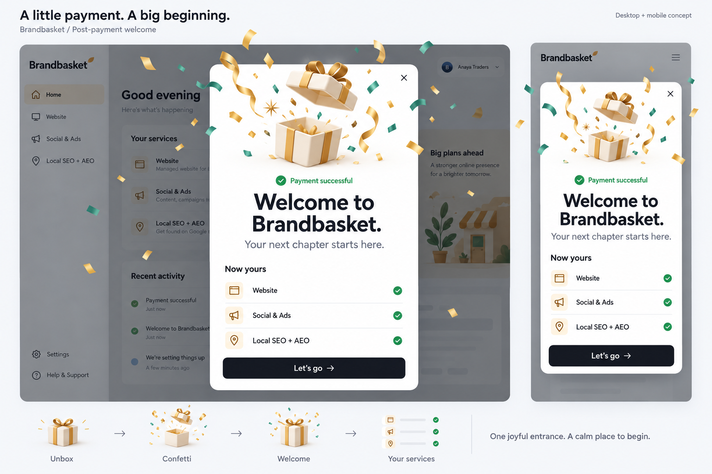

# Brandbasket payment welcome: the unboxing

Design proposal, 31 October 2026.

The generated visual illustrates the proposed direction. Its surrounding dashboard and logo are conceptual; implementation must retain the app's actual navigation and existing brand assets. The specification below governs service marks and responsive behavior.

## Review of the current popup

Reviewed `brandbasket-platform/apps/platform/components/first-look/payment-welcome.tsx`, `fire-poppers.ts`, `lib/celebration.ts`, the existing component tests and `apps/platform/DESIGN.md`. The local app redirects an unauthenticated visit to sign-in, so these observations come from the implementation, rather than a signed-in visual session.

The existing popup already has two confetti cannons, a 500ms content entrance and staggered service checkmarks. Its underlying presentation is a small text-first card: a 28px welcome heading, a plain service list and a full-width button. After the short confetti effect, there is no lasting visual focal point. Payment confirmation is implicit, and there is little sense of a new beginning.

Keep the existing strengths: one main action, purchased services only, native dialog focus management, Escape dismissal, reduced-motion support and removal of `welcome=1` when dismissed.

## Creative direction

Reading this as a celebratory product moment for local business owners, using Brandbasket's established light customer-portal design system. Visual variance 7/10, motion intensity 7/10 for the entrance, visual density 3/10. Motion settles completely after the introduction.

### Recommended: the Brandbasket unboxing

An opened paper gift, warm gold ribbon and a small cloud of gold and teal paper give the card a memorable focal point. The lid lifts, the ribbon opens, and the services appear underneath. The gift is an illustration of the welcome moment; it does not imply an extra free product or promotional reward.

The still composition must feel celebratory on its own. Motion enhances the composition rather than carrying all of its personality.

### Alternatives considered

1. Confetti crescendo: a large welcome heading with a branded check and corner cannons. Simple to implement with the existing effect, but less distinctive.
2. Launch ticket: a perforated invitation-style card with an illustrated ribbon. More graphic and collectible, but the ticket metaphor is less closely connected to the brand and the service purchase.

## Composition and proposed copy

Desktop modal: approximately 520px maximum width, 32px side padding, white surface and existing lift shadow. Use the existing radius token when implemented. A contained illustration occupies approximately 140px above the content; decorative streamers can extend outside the upper corners without overlapping the close target.

Content order:

1. Illustration: paper gift with an opening lid and gold ribbon.
2. Small check and explicit confirmation: `Payment successful`.
3. Heading: `Welcome to Brandbasket.` Display type around 34px on desktop, 28px on phones, balanced over two lines.
4. Supporting line: `Your next chapter starts here.`
5. `Now yours`, followed by only the purchased services, using their existing names and service marks.
6. Existing main action: `Let’s go`, with a quiet directional arrow.

The new supporting and confirmation copy are proposals for review. An unlocked service must not be described as a finished website or an active campaign. There are no new delivery promises, prices or extra offers.

For no services, omit the list and its label. For one service, show a single row without unnecessary separators. For longer service names, let text wrap and keep the check visible. Keep the interface brand-aware using the existing brand provider.

## Motion choreography

Timing is relative to opening the confirmed-payment dialog:

| Time | Event |
| --- | --- |
| 0 to 180ms | Backdrop appears and the card lifts by a small distance. |
| 180 to 650ms | Gift lid lifts and ribbon opens with a gentle overshoot. |
| 400 to 1800ms | A single coordinated burst of gold, sage and teal paper spreads around the upper card and falls away. |
| 500 to 850ms | Payment confirmation and welcome content appear. |
| 750 to 1150ms | Purchased services reveal in sequence. |
| By 1200ms | All content and the main action are visible. |
| By 3000ms | Decorative motion has ended; the complete composition remains. |

The main action is usable immediately, even during its entrance. No sound, autoplay video, looping bobbing or automatic dismissal. Implement motion with transforms and opacity. Confetti should use elapsed time so its duration does not vary with screen refresh rate. Cancel animation work on close and unmount. Decorative layers must not intercept input.

The motion proposal intentionally extends the app's normal 200ms micro-interactions for this explicitly requested celebration moment. Keep the rest of the portal's motion unchanged.

## Visual system

Preserve Red Hat Display and Red Hat Text. Use the existing `surface`, `ink`, `ink-2`, `rattan`, `rattan-wash`, `ok`, `ok-wash` and service-color tokens. Gold is decorative; small gold text uses `rattan-text` or `rattan-ink` for contrast. Preserve the app's light theme and single dark main button. No glass or UI gradients. Dimensional shading belongs inside the illustration asset, not the interface surfaces.

The gift is an illustration, not a replacement logo. Any implementation must use the existing brand assets unchanged and must not convert the entire generated mockup into a flattened app screen.

## Mobile and accessibility

- Maintain at least 16px outer gutters on a 390px viewport; work down to 320px without sideways scrolling.
- Reduce illustration height to approximately 105px. Reserve room for the button and use a scrollable content region on short viewports.
- Keep the native dialog, accessible heading and focus restoration. Add a 44px close target with an accessible name.
- Describe the dialog with its payment-confirmation text. Hide decorative artwork and confetti from assistive technology.
- Respect reduced motion by rendering the gift already open, all copy visible and the complete service list present immediately, without confetti.
- Preserve visible keyboard focus, Escape dismissal and the existing non-replaying close behavior.

## Implementation acceptance criteria

- Trigger only through the existing confirmed-payment welcome flow.
- Match the brand-aware heading and actual purchased services.
- Preserve other query parameters when removing the welcome parameter.
- Test main-action and Escape dismissal, animation cleanup, no-service and multiple-service states, and reduced motion.
- Visually check desktop, 390px mobile, 320px mobile and a short viewport.
- Run the touched project's lint, TypeScript, unit tests and production build before reporting implementation complete.

## Deliverable scope

This deliverable is a creative direction and generated desktop/mobile visual concept. Application source has not been edited as part of this design review.
