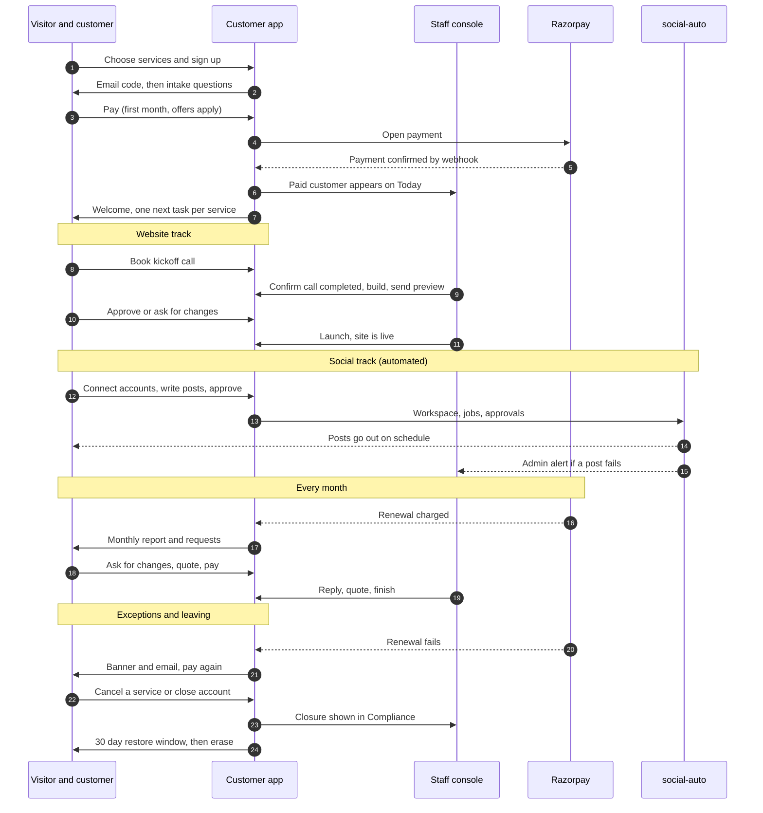

# BrandBasket end to end user journey (customer app and staff console)

This is the main journey document. It follows one customer from first visit to leaving, and shows at every step what they see in the customer app (`app.brandbasket.in`), what the BrandBasket team sees and does in the staff console (`console.brandbasket.in`), what the system or an outside service does, and which message goes out. UI polish is not covered here.

**Scope as the owner set it (2026-11-14):**
- Offers stay as they are today: ₹1 first month on Social and Ads, "Yearly, Save 10%", Dedicated Expert Monitoring free with all three plans. (The written pricing rules in `CLAUDE.md` do not match these and need updating.)
- Paid Ads stays on sale as it is for now. Nothing operates it yet, so it is shown here as a display service.
- Social Media Management is automated by social-auto. The customer does the setup and runs it in the app. The single admin does not interfere.
- Social and Ads have no setup call. Website keeps its kickoff call.
- The customer is messaged when staff start work.
- There is one staff account. All support and every other task done by BrandBasket staff is done from that account in the staff console.

**Status labels:** Works, Gap (something missing or wrong), Not built, Verified in browser (B), Verified in code (C), Unknown (U). Paths are real routes. Evidence is in `04`, `05`, `15`, `16`, `18`.

## Who is in the journey

| Person | Where | Role |
|---|---|---|
| Owner | Customer app | Buys, pays, approves, invites, cancels |
| Editor, viewer | Customer app | Editor edits and approves, viewer only reads |
| BrandBasket team: one staff account (admin role) | Staff console (the owner wrote admin.brandbasket.in, the code uses console.brandbasket.in) and the social-auto dashboard | All support, finance, build, compliance and Social monitoring work is done from this one account |
| social-auto | Outside service | Writes and posts Social content |
| Razorpay, Cal.com, Brevo | Outside services | Payments, call booking, email |

## The whole journey on one diagram

---

## Phase 1. Discover and choose services

| Step | Customer | Staff console | System and messages | Status |
|---|---|---|---|---|
| 1.1 | On the marketing site, picks Website, Social, Paid Ads or any mix. The button links to `/signup?plan=website,social,ads` | If the site's enquiry form is used instead, an enquiry appears in Enquiries and on Today (1 hour limit) | `/api/leads` receives the enquiry | Works (C). The site is another repo, not audited |
| 1.2 | Sees prices with GST included (₹2,999 each, ₹6,000 monitoring, free with all three) | none | `/api/pricing` | Works. U: whether the site's strike-through prices match |

## Phase 2. Sign up and verify

| Step | Customer | Staff console | System and messages | Status |
|---|---|---|---|---|
| 2.1 | `/signup`: business name, name, email, country, state, mobile, password, terms | none | none yet | Works (B). Gap (B): the side panel lists website steps even for a Social or Ads link. Mobile must be unique per account |
| 2.2 | Presses "Email me a code" | none | 6-digit code emailed, valid 10 minutes. Limit: 10 code requests an hour per network, 3 per email per 10 minutes | Works (B) |
| 2.3 | Enters the code, account is created, lands on `/start` | none | Account and a business in unpaid state (`kind = listing`) are created | Works (B). Gap: the code step is lost on a refresh |
| 2.4 | Wrong code, expired code, too many tries: clear messages and a countdown | none | Rate limit buckets | Works (C) |

## Phase 3. Intake questions (before paying)

| Step | Customer | Staff console | System and messages | Status |
|---|---|---|---|---|
| 3.1 | `/start` asks 3 to 5 short questions (3 for Ads alone, 5 for Website). Each answer saves. "Skip for now" goes straight to checkout | The client's Overview shows "What they told us", read-only | Answers saved per question | Works (B) |
| 3.2 | Until they pay, every other page sends them back to `/start`, so Settings, Billing and Help are unreachable | none | Layout guard | Gap (B): cannot reach Help or fix details |

## Phase 4. Basket and price

| Step | Customer | Staff console | System and messages | Status |
|---|---|---|---|---|
| 4.1 | Basket summary lists services with GST. "Change services" adds or removes a service | none | Basket kept in the address | Works (B) |
| 4.2 | Offers shown as live today: Social and Ads first month ₹1 (₹0.16 of it GST), then ₹2,999 each month; "Yearly, Save 10%"; monitoring free with all three; a "Have a code?" box | none | Offer rules in the billing code | Works (B). Gap: written rules disagree (decision D1, D2) |

## Phase 5. Pay

| Step | Customer | Staff console | System and messages | Status |
|---|---|---|---|---|
| 5.1 | `/checkout`: billing details (GSTIN optional, address), then Pay opens a confirm dialog, then the payment window (a test page locally) | none | Subscription created as incomplete, lines pending | Works (B, fake provider) |
| 5.2 | Paid: lands on Home with a welcome | Payments shows it, tax invoice issued in the same step | Webhook records the payment once, lines become active, receipt email | Works (B) |
| 5.3 | Pending: "waiting" screen with reload | none | Waits for the webhook | Works (C) |
| 5.4 | Failed or window closed: "We could not confirm that payment, try again" | none | Nothing recorded | Works (C) |
| 5.5 | Webhook lost: stays on waiting until they reload checkout | The one staff account sees "Payment needs a look" on Today if the payment is flagged. The 10 minute job covers the ₹1 offer checkouts and its timer may not be enabled | Page-load recovery asks Razorpay | Gap (C), P0 item |
| 5.6 | Money arrives but nothing is bought (cancelled or replaced subscription) | Stored as an unapplied payment, finance refunds by hand | `attention_reason` set | Gap (C): no customer message, refund moves no money |
| 5.7 | Abandons before paying | Today shows "Signed up, not paid" after 2 days, no owner | none | Gap: owner decided one reminder email after 1 day and an owner on the row. Not built |

## Phase 6. Day 0: Welcome and first tasks

| Step | Customer | Staff console | System and messages | Status |
|---|---|---|---|---|
| 6.1 | Home says "Your plan is active" and shows one next action per service | A "New add-on to set up" row appears on Today for Social, Ads, monitoring (Website gets a kickoff row instead) | none | Works (B) |
| 6.2 | Website: "Book your kickoff call" with a day and time picker | `/calls` shows it after booking | Cal.com booking | Works (B) |
| 6.3 | Social: should show "Set up Social" (connect accounts, write posts). Today Home shows a kickoff card worded for Social | Nothing needed from staff | none | Gap (B): Home offers a call that the owner says does not exist |
| 6.4 | Ads: shows the same Social setup and kickoff card (shares Social's access) | The same generic row | none | Gap (B): see Phase 9 |
| 6.5 | The customer is told when staff start work | "Mark started" on the staff task | "We have started" message and a Home line | Owner decided yes. Not built |

## Phase 7. Website journey (about 2 weeks)

| Step | Customer | Staff console | System and messages | Status |
|---|---|---|---|---|
| 7.1 | Books and attends the 30 minute kickoff call. Booked: "Your kickoff call is booked for `<time>`" After the call time, before confirmation: "We will start your website right after your call" After Call completed: "Thanks for the call. We are getting your website started" | When the call time passes, a popup in the console asks "Did the kickoff call with `<business>` happen?" with Call completed (notes optional), They did not join, and Reschedule. A notification repeats it until answered, and the same prompt is on Today. No other screen has this button | Call completed starts the build and the 48 hour first-preview clock. If nobody answers within 24 hours the build starts automatically, labelled "Started without call confirmation" and shown on Today | Decided 2026-11-14 (D31). Not built: today the action is called "mark held" and sits in four places |
| 7.2 | Home: "We are preparing your website", then "We are building your website" | Client Website tab and Board: builder, Start building. Today lists it only if a due date exists | Project goes submitted, building. First preview due 48 hours after the call | Works. Gap: builder optional |
| 7.3 | Preview email arrives | Builder sends the preview | Email links the external preview and says "Reply" | Gap (C): approval is only in the dashboard, a reply skips the round count |
| 7.4 | `/website`: sees the preview. "Approve and go live" or "Ask for changes" (dialog). Editors can approve, viewers cannot | Changes: a ticket and a round counted, team alerted. Approve: team email | Changes-received email | Works (C) |
| 7.5 | "We are making your changes" | Builder sends an updated preview | Updated preview email | Works. Gap: the revision shows a stale late label |
| 7.6 | "You approved the preview" | Approved previews have no Today row; Board column only | Team email | Gap (C) |
| 7.7 | "Your website is live", for 7 days, then ongoing Home | Eight launch checks, optional address check, Mark live | Live email, resend for 7 days | Works. Hosting pause timer may not be enabled |
| 7.8 | Moves to their own domain, edits pages and blog, asks for changes | Domain move has no queue or owner | Email when switched | Gap (C) |
| 7.9 | Support can cancel a build, add a free round or put it on hold | Available to the one staff account | none | Not a role issue any more. Keep a confirmation on cancel build |

## Phase 8. Social journey (automated by social-auto, no staff work)

| Step | Customer (`/social`) | Staff console and admin | social-auto and messages | Status |
|---|---|---|---|---|
| 8.1 | Opens Social, which creates their workspace | Nothing | Workspace created per business | Works (C) |
| 8.2 | Connects Instagram, Facebook Pages, LinkedIn and Google: Allow link, comes back to `/social` | Nothing | Connect link valid 1 hour, tokens stored | Works (C). Gap: clear failure and retry |
| 8.3 | Confirms their website and presses "Write my posts" | Nothing | Write job: reading, writing, drawing, review. Limits 3 batches a day, 10 a month | Works (C). Gap: told only by reloading |
| 8.4 | Keeps or drops facts and topics, asks for pictures (7 a week per channel), approves each picture, or turns on automatic posting per channel with consent | Nothing | Only approved pictures are posted. Auto approval is announced | Works in social-auto. Gap: Brandbasket sends no notice |
| 8.5 | Chooses weekdays per channel | Nothing | Applied to later batches | Works (C) |
| 8.6 | Sees the calendar. Can edit, delete or send now before a post goes out | Nothing | Publisher posts daily | Works (C) |
| 8.7 | A post fails or a connection is about to expire | Single admin gets a push alert from social-auto | Events exist but Brandbasket has no receiver | Gap (C): the customer is not told |
| 8.8 | Analytics and the monthly report | Nothing | Daily collection by timer | Works if the timer runs (U) |
| 8.9 | Social is on the ₹1 offer: first month ₹1, then ₹2,999 | Payments shows the first charge and the later renewal | Razorpay subscription | Works (B). U: whether the customer is warned before the first full charge |
| 8.10 | Cancels or lapses | Nothing tells social-auto to stop | none | Gap (C): posting may continue after lapse |

## Phase 9. Paid Ads (display only for now)

| Step | Customer | Staff console | System and messages | Status |
|---|---|---|---|---|
| 9.1 | Can buy it today (₹2,999, or ₹1 first month). A customer without it who opens `/ads` is offered the Social plan, not Paid Ads | Nothing operates it | none | Gap (B) |
| 9.2 | An ads-only customer gets all Social screens and a Social kickoff offer | A generic "Add-on to start: Paid Ads" row; the client page says "Nothing is waiting on us" | none | Gap (B) |
| 9.3 | Sees an Ads page with "No ad figures for this month yet" | Staff can enter numbers under "Plan and billing", combined as "Social & Ads" | none | Display only. Owner defers the real workflow |

## Phase 10. First 30 days checkpoints

| Step | Customer | Staff console | System and messages | Status |
|---|---|---|---|---|
| 10.1 | First monthly report appears under Reports | Report is drafted, reviewed, sent | Report email | Gap: the report timer is installed, not enabled (U in production) |
| 10.2 | First full-price charge (₹2,999 after the ₹1 month, or the yearly amount) | Payments shows it | Razorpay renews | Works (C). U: a pre-renewal notice |
| 10.3 | Reads what was delivered: live site, scheduled posts | Today and the client page | none | Works |

## Phase 11. Ongoing month

| Step | Customer | Staff console | System and messages | Status |
|---|---|---|---|---|
| 11.1 | Renewal is charged on one basket date | Webhook records it, invoice issued | Receipt email | Works (C) |
| 11.2 | Asks for a change or a question (Requests, "Ask for a change") | Requests queue: owner set by hand, clocks 4 hours (soon) and 24 hours (late) | Team alert. No confirmation email to the customer | Works. Gap: no acknowledgement |
| 11.3 | Gets a quote, accepts, pays the change | Staff reply with a quote, then work, then finish | Emails per move | Works. Gap: a paid request can look "waiting on client" |
| 11.4 | Approves the finished change or reopens it | Ticket closes | Emails | Works |
| 11.5 | Owner invites an editor or viewer at Settings, Team | none | Invite email | Works (B) |
| 11.6 | Invitee opens the link, creates an account, presses "Join the dashboard" | none | Two memberships exist (their own and the inviter's) | Gap (B): they land on their own sign-up questions, not the inviter's dashboard |
| 11.7 | Bell and email links open the right page | none | none | Gap (B): signed-out links lose their target and land on `/login` |

## Phase 12. When things go wrong

| Step | Customer | Staff console | System and messages | Status |
|---|---|---|---|---|
| 12.1 | Renewal fails: banner "We could not take your last payment", failed-payment email with Pay now | Only a notice on the client page, nothing on Today | Status re-read from Razorpay | Gap (C): Pay now goes to `/billing`, which ends in a request to staff |
| 12.2 | Billing period lapses: can still read, writes go to Billing | Nothing on Today; no written lapse policy; hosting pause timer may be off | Status lapsed, email | Gap (C) |
| 12.3 | Owner reactivates and pays | Payment recorded | Receipt | Works (C) |
| 12.4 | Adds a service from Plan and billing | Today row "Add-on to start" | New line, receipt | Works. Same gaps as Phase 6 |
| 12.5 | Cancels one service: it runs to the end of the paid month | No queue, row shows the pending end | `end_requested_at` set | Works. Gap: navigation drops the service at once |
| 12.6 | Asks for help | Support request, owner and clock | Reply email | Works |
| 12.7 | Sends a privacy request | Compliance page for the admin only, no owner, not on Today | Open, closed | Gap (C) |

## Phase 13. Leaving

| Step | Customer | Staff console | System and messages | Status |
|---|---|---|---|---|
| 13.1 | Closes the account in Settings: locked for 30 days with a restore link | Clients "Leaving", Compliance "Accounts being erased" | Closure recorded, email | Works (C) |
| 13.2 | Restores within 30 days | Admin can restore or extend | Back to the last plan | Works (C) |
| 13.3 | After 30 days the account is erased | Compliance shows it | Erase timer is installed, not enabled. Run order deletes content before the locked re-check | Gap (C) |
| 13.4 | Refund | Finance marks the payment refunded | Nothing is sent to Razorpay, no credit note, no customer email | Gap (C) |

---

## One staff account: what it changes

The owner decided that all BrandBasket staff work is done from one account in the staff console.

| Area | What changes |
|---|---|
| Roles | The support, finance and admin split is not needed. The account is an admin and sees everything. The earlier finding that support can cancel builds is no longer a role problem |
| Owners and queues | Every item belongs to that account, so "Unowned" and "my work" filters have no meaning. Today is a single list ordered by what is late first |
| Auto assignment | Not needed. Remove it from the plan |
| Social | Still no staff work. The same account watches the social-auto alerts |

New risks that follow from one account (not blockers, but they need an answer):

| Risk | Why it matters | Recommendation |
|---|---|---|
| One password protects customer data, payments, refunds and erasure | A single leaked or guessed password exposes everything | Put the console behind Cloudflare Access, add a second factor, keep the login rate limit |
| No separation of duties | The same account issues refunds and invoices and answers customers | Keep the access log and review it regularly |
| Key person dependency | If the one person is away or locked out nobody can run support or payments | Keep a recovery path, for example a second admin credential kept offline by the owner |
| The access log cannot tell people apart | Anyone sharing the login looks like the same user | If more than one person ever works in the console, give each a named account |

## Where the journey breaks today (ranked)

| # | Break | Phases | Why it matters |
|---|---|---|---|
| 1 | Ads-only and Ads purchasers get Social, and the Ads page sells Social | 6, 9 | Customers pay for one thing and get another |
| 2 | Invitees land on the wrong workspace | 11 | Team feature does not work |
| 3 | Social failures and expiring connections never reach the customer, and a lapse does not stop posting | 8 | Silent failures and cost |
| 4 | A lost first payment is only recovered on a checkout reload | 5 | Paid customers locked out |
| 5 | No owner or queue for paid work other than Website | 6, 7, 12 | Requests fall through |
| 6 | Refund moves no money, erase and report timers may be off | 10, 13 | Money and data promises |
| 7 | Written pricing rules disagree with the live offers | 4 | Mismatch between site, app and docs |
| 8 | Signed-out email links lose their target; unpaid sign-ups are locked out of Help | 2, 3, 11 | Friction at the first and every later visit |

## What to confirm next

1. Does the owner confirm Phases 1 to 5 as the correct sign-up and payment flow, with the live offers kept?
2. For Social, is the customer expected to be emailed about failures and expiring connections (recommended), or only shown them in the app?
3. For Phase 6.5, which events start the "we have started" message for Website (builder assigned, preview started) and what wording?
4. Lapse policy (Phase 12.2): how long after a failed payment before hosting pauses and posting stops?
