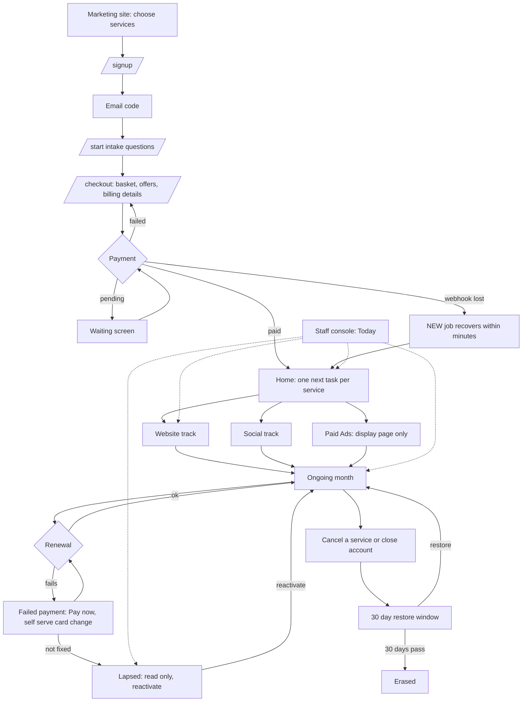
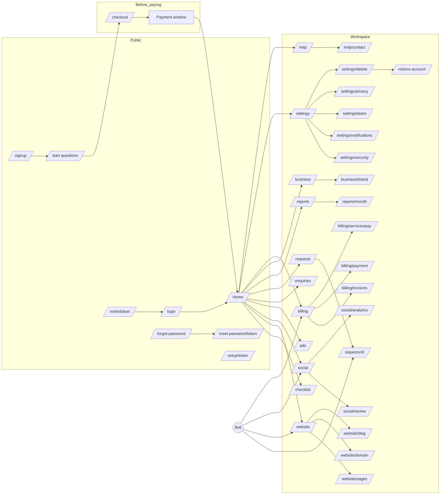
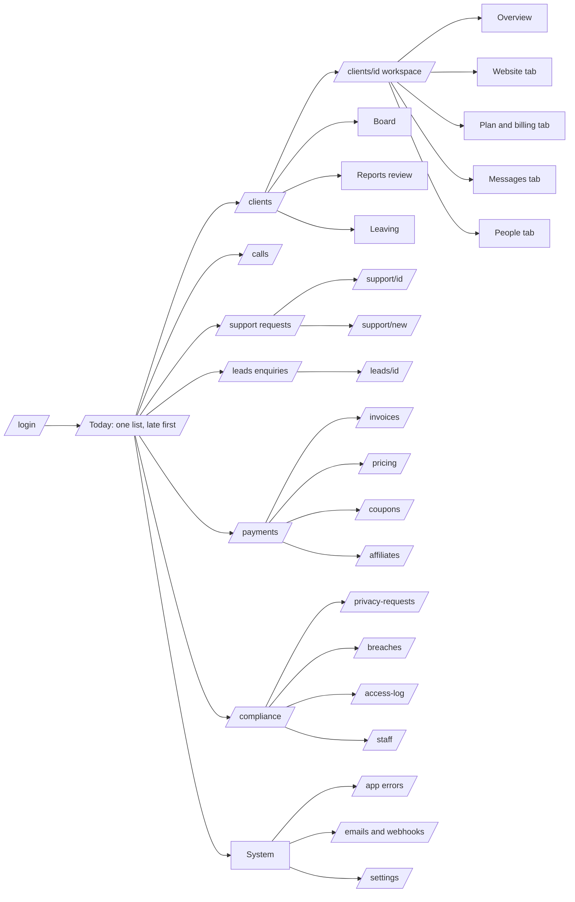
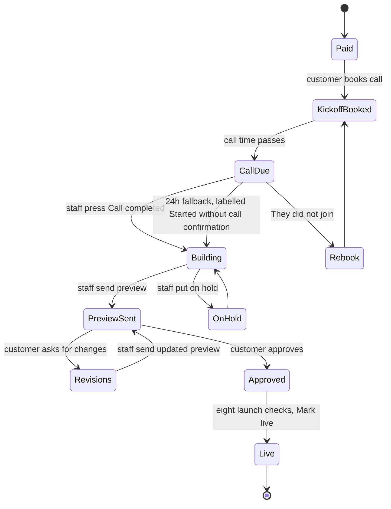
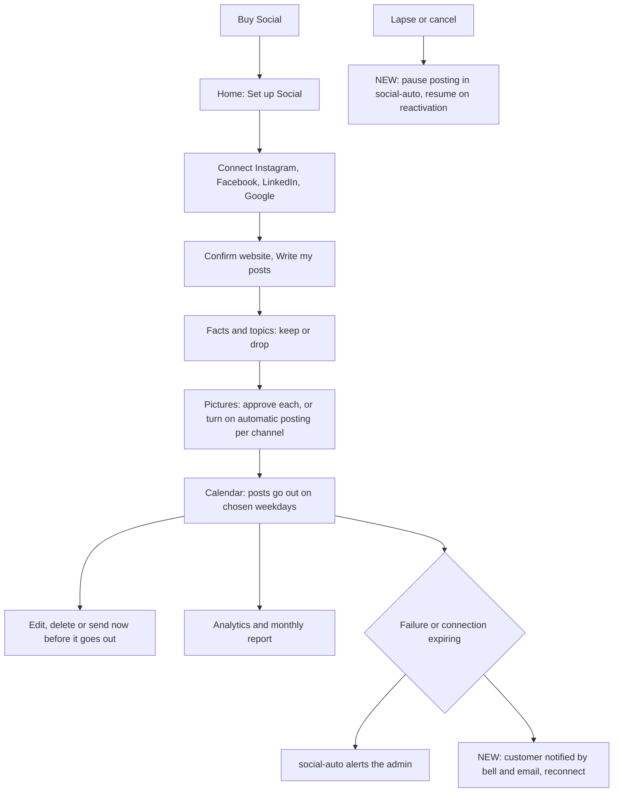
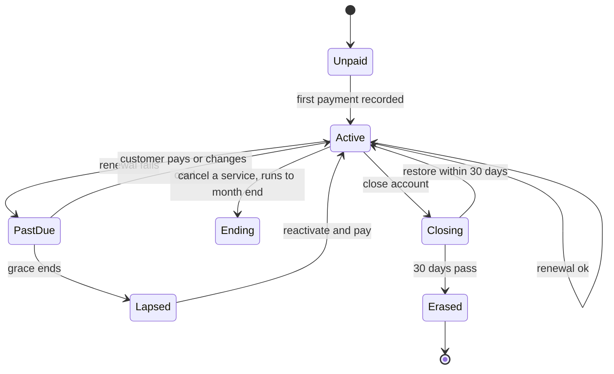
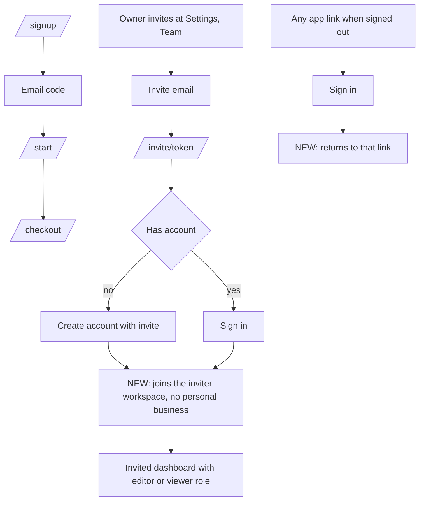

# Final user flow and journey diagrams (both apps)

The target journey from `19`, drawn. Decisions applied: one staff account, offers kept, Social automated by social-auto, Paid Ads display only, "Call completed" kickoff prompt, customer told when work starts. Boxes marked NEW are in the Release 1 or 2 packages, the rest exists today. Diagrams are Mermaid: open this file in a viewer that renders it.

## 1. The whole lifecycle across both apps

## 2. Customer app: every page and where it leads

What each page is for (customer):

| Page | Job | Main action | Staff counterpart |
|---|---|---|---|
| `/signup`, `/start`, `/checkout` | Create account, answer questions, pay | Pay | Payments, client Overview |
| `/` Home | One next action per service, status | Next task | Today, client workspace |
| `/checklist` | Setup items | Save item | client Overview setup answers |
| `/website` | Kickoff, preview, approve, live | Approve or ask for changes | client Website tab, Calls, Board |
| `/website/pages`, `/domain`, `/blog` | Edit pages, move domain, write posts | Save, request move | client Website tab |
| `/social` | Connect, write posts, approve pictures, calendar | Approve | read-only Social status, social-auto dashboard |
| `/social/review`, `/analytics` | Review posts, numbers | Approve | same |
| `/ads` | Paid Ads information | Add to plan | client Plan and billing |
| `/enquiries` | Leads from their site | View | none |
| `/requests`, `/requests/id` | Ask, quote, pay, approve | Send, accept quote | Requests |
| `/reports`, `/reports/month` | Monthly report | Download | Reports |
| `/business`, `/business/brand` | Business profile and brand | Save | client People and Website |
| `/billing` and children | Plan, services, invoices, card, add or cancel | Pay, add, cancel | Payments, Invoices, client billing |
| `/settings` and children | Profile, security, notifications, team, privacy, delete | Save, invite, delete | People, Compliance |
| `/help`, `/help/contact` | Help and calls | Send | Requests |
| `/restore-account` | Undo deletion | Restore | Leaving, Compliance |

## 3. Staff console: every page and where it leads (one staff account)

Staff console pages and what each does:

| Page | Job | Customer result |
|---|---|---|
| Today | Everything that needs action, late first | none, it points to the rest |
| Calls | Kickoff popup: Call completed, They did not join, Reschedule (NEW) | Customer status "Thanks for the call. We are getting your website started" |
| Clients, client workspace | One tab per service bought; Overview, Website, Plan and billing, Messages, People | Mirrors the customer's status |
| Board | Website projects by stage | Customer sees the stage headline |
| Reports | Review and send monthly reports | Report email and `/reports` |
| Requests (`/support`) | Reply, quote, close | Customer thread, emails |
| Enquiries (`/leads`) | BrandBasket's own sales enquiries | Setup link email |
| Payments, Invoices | Money, flagged payments, refund (NEW real refund), credit note | Receipt, refund email |
| Pricing, Coupons, Affiliates | Prices and codes | Checkout |
| Compliance: privacy requests, breaches, access log, staff | Legal duties, audit trail, the one account | Confirmation emails |
| System: app errors, emails and webhooks, settings | Health, retries | none |

## 4. Website track (both sides)

Customer sees: booked, "We will start your website right after your call", "Thanks for the call. We are getting your website started", "We are building", "Your preview is ready" (approve here, not by email reply), "We are making your changes", "You approved the preview", "Your website is live". Staff sees: Calls popup, Board column, Today rows (NEW: approved previews, revisions due, domain moves).

## 5. Social track (automated, no staff work)

## 6. Billing and subscription states

## 7. Sign up and invite flows

## 8. Feature checklist (customer and staff)

| Feature | Customer app | Staff console | Release |
|---|---|---|---|
| Sign up, email code, intake | yes | client Overview shows answers | exists, small fixes in 1 |
| Basket, offers, GST, checkout | yes | Payments, Invoices | exists |
| Lost payment recovery | transparent | Today row, job | 1 |
| Unpaid reach Help and Settings | yes | none | 1 |
| Abandoned sign-up reminder | email | Today row | 1 |
| Kickoff booking | Home | Calls | exists |
| Call completed prompt | status text | popup, notification, Today | 1 |
| Preview approve or ask changes | `/website` | Board, Requests | exists, email fix in 1 |
| Social setup and approvals | `/social` | read-only status | exists |
| Social failure notices | bell, email | none | 1c or 2 |
| Pause Social on lapse | none | none | 1c or 2 |
| Paid Ads | display only | generic row | deferred |
| Requests, quotes, pay | `/requests` | Requests | exists, acknowledgement in 1 |
| Return to link after sign in | yes | none | 1 |
| Reports | `/reports` | Reports review | exists, timer to enable |
| Team invites | Settings, Team | People | fix in 1 |
| Failed renewal and card change | Billing, email | Today row | 1 |
| Refund | refund email | Payments | 1 |
| Cancel service, close account, restore | Billing, Settings | Compliance, Leaving | exists, erase fix in 1 |
| Privacy requests, breaches | Settings, Privacy | Compliance, Today row | 2 |
| One staff account protection | none | Cloudflare Access, confirm dialogs | 1 |
| UI patterns, Home cards, console redesign | Release 2 | Release 2 | 2 |
