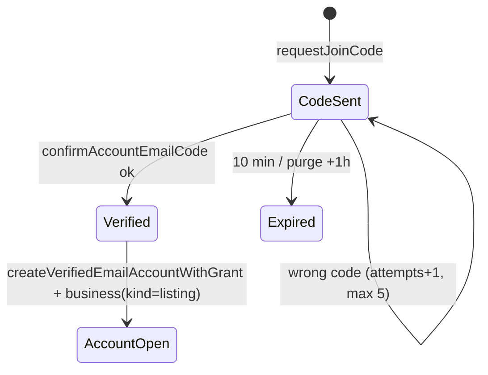
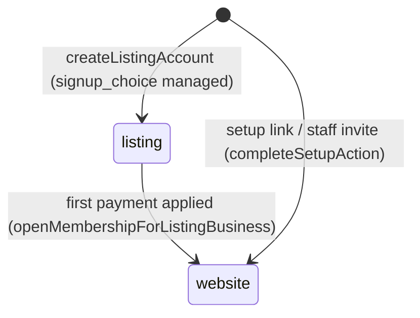
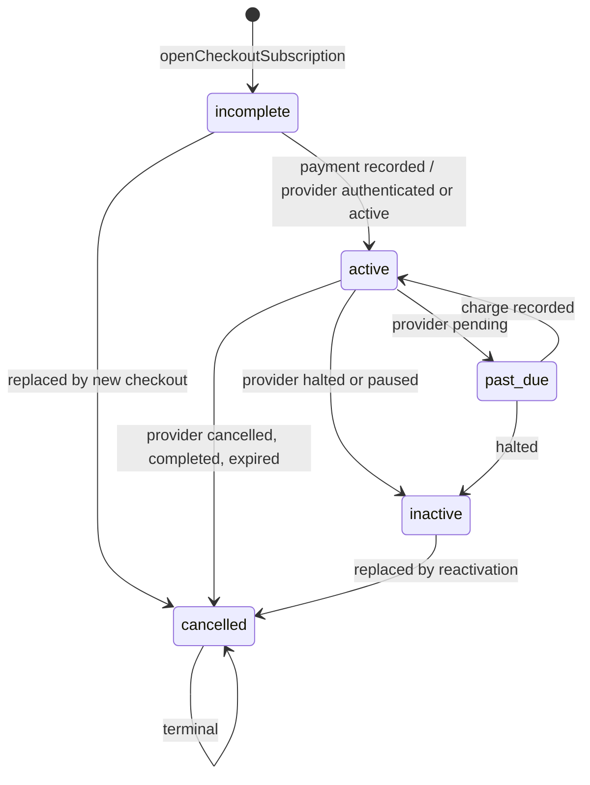
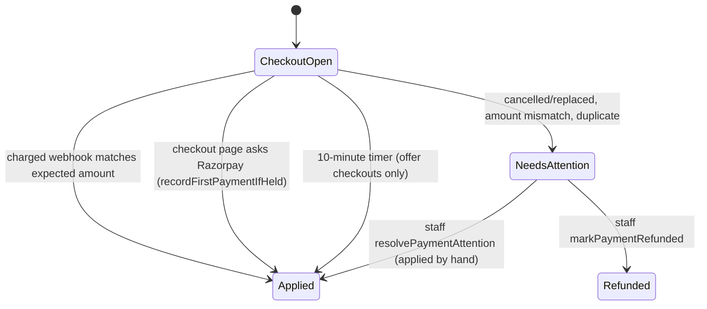
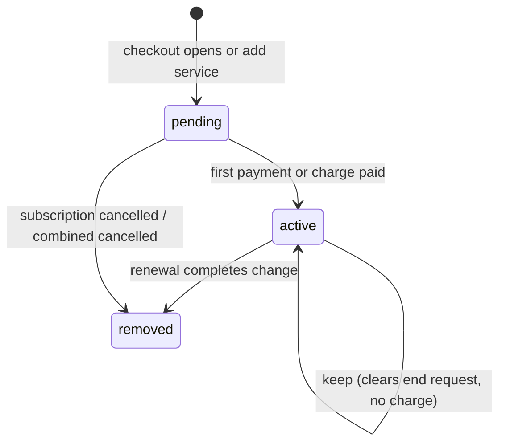
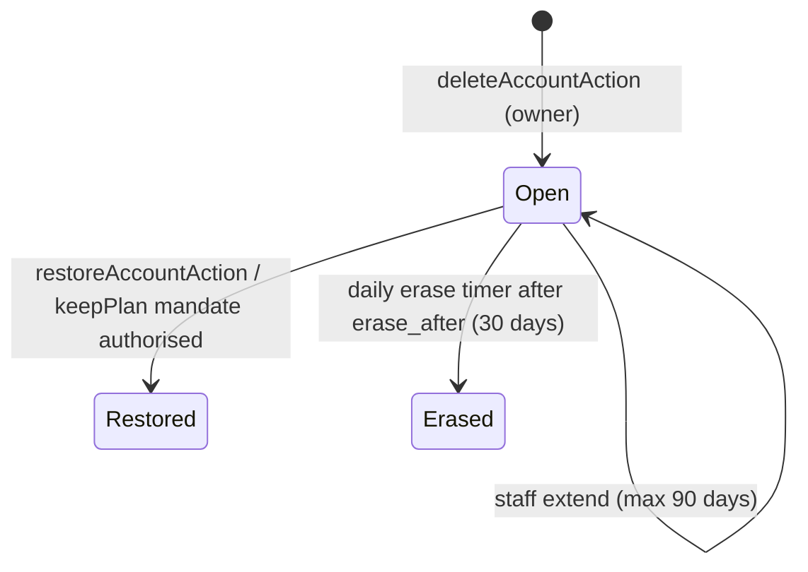
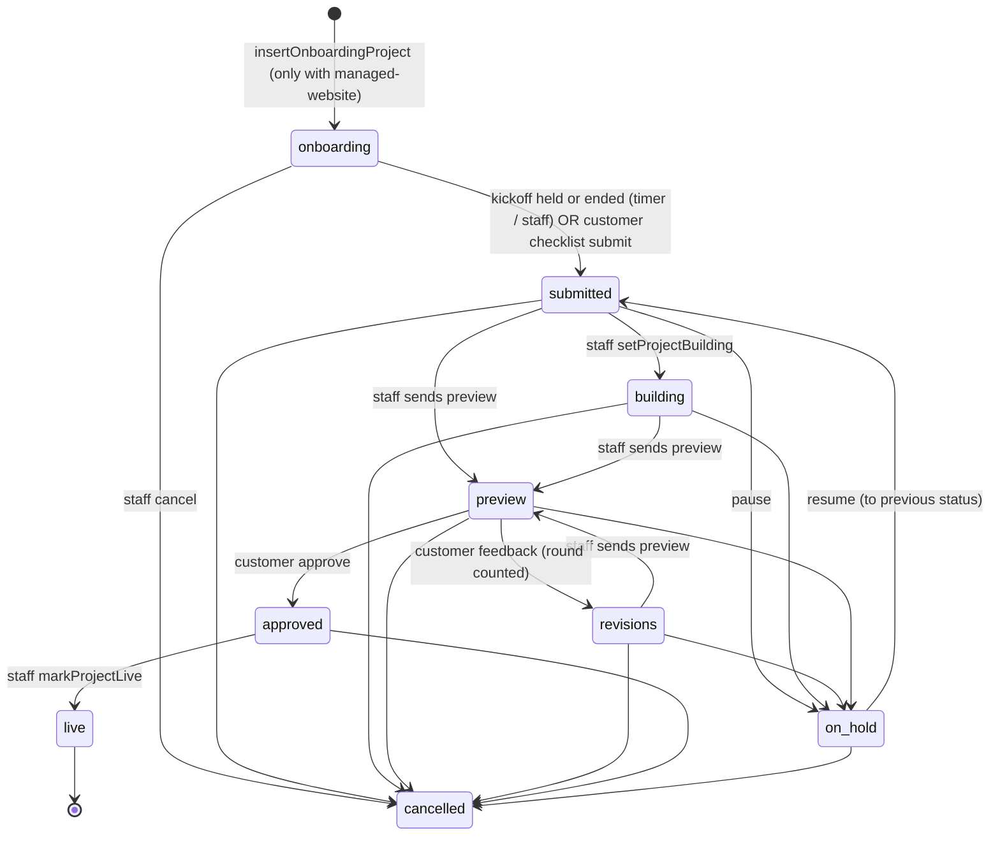
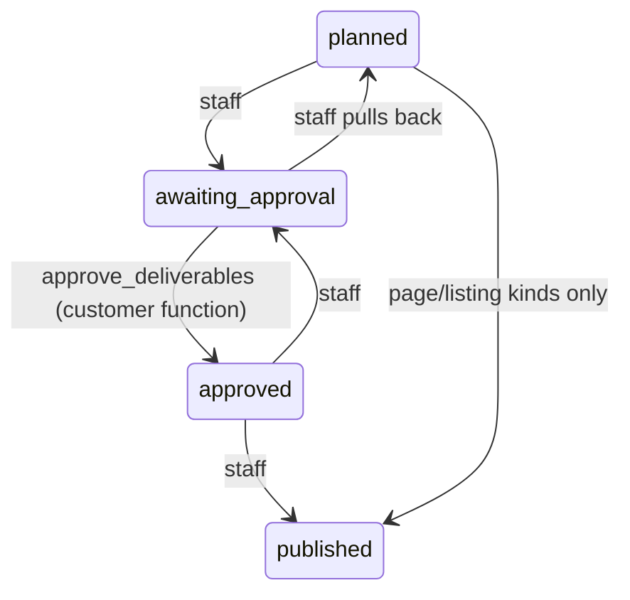

# State machines (domain-architect audit)

Commit c702f6c7. Labels: V Verified in code, H Reported in historical document, I Inferred, U Unknown. Paths relative to brandbasket-platform.
Table columns: from | event | guard/role | to | DB write | side effects | idempotency | customer surface | admin surface | failure/retry.

## 0. Inventory (V)
- `pgEnum` declarations in `packages/db/src/schema`: 62 (grep `pgEnum(`). Business-relevant: account_otp_purpose, billing_currency, project_status (9), project_kind, onboarding_step, business_module, add_on_subscription_status (6), bundled_add_on_status (3), press_release_status, chatbot_status, lead_status (8), lead_source, affiliate_earning_status, appointment_status/source, business_member_role, business_kind, signup_choice, account_exit_reason/outcome, domain_status (6), kickoff_outcome, referral_value_kind, billing_provider, billing_interval, subscription_status (5), payment_kind (6), payment_status (3), payment_attention_reason (8), plan_tier (1), charge_kind (9), charge_status (3), plan_upgrade_status (5), plan_upgrade_source, plan_price_field, support_* (6 enums), media_asset_status/purpose. Directory enums (17 plus 2 geo) are dormant, see dormant-code.md.
- Text status columns with TS union types plus CHECK or trigger (V): `change_requests.state` (9, trigger `change_requests_guard` migration 0190), `deliverables.status` (4, trigger `deliverables_guard` 0193), `report_documents.state` (4, trigger 0202), `report_sources.status` (5), `team_calls.status` (3, trigger `team_calls_guard` 0191), `connected_accounts.status` (3), `conversion_events.status` (4), `email_messages.status` (3), `enquiries.status` (4), `error_issues.status`, `google_connections.status` (2), `site_checks.status` (3), `privacy_requests.status` (4), `breach_register.status` (3), `webhook_events.result` (4), `alert_deliveries.result` (4).
- Implicit machines with no status column (V): auth/OTP (row presence), business invites (accepted_at/revoked_at), account closures (restored_at/erased_at), setup call bookings (held_at), preview versions, onboarding progress (completed_at), preview feedback tickets, subscription cancel request (cancel_requested_at), add-on end request (end_requested_at).
- Authoritative-source problems are listed at the end of each machine and in section 33.

---
## 1. Sign-up and email OTP (V)

| from | event | guard/role | to | DB write | side effects | idempotency | customer surface | admin surface | failure/retry |
|---|---|---|---|---|---|---|---|---|---|
| none | requestJoinCode (features/entry/server/listing-account.ts:73) | public, 10 codes/h/network, email and phone not already used | code row | `account_otps` (hash, attempts 0, expires 10 min; schema/account-otps.ts:21) | Brevo email via outbox | one live code per email not enforced (I) | /signup | Outbox, Emails page | `limited` result, retry later |
| code row | confirm (account-email-code.ts) | attempts under 5, not expired | deleted | row deleted on use | account grant for email | single-use | /signup | none | wrong-code message |
| deleted | createListingAccount (listing-account.ts:119) | 5 attempts/h/network | user + business(kind listing, signup_choice managed) + owner membership | `users`, `accounts`, `businesses`, `business_members`, `signup_attribution`, lead (`recordSignupLead`) | signed in, consent record, ad conversion `reportSignUpToAds` | user-already-has-business refused (db) | /signup to /start or /checkout | Leads list (source signup) | account created before business: staff repair (comment :34-40) |
Notes: `staff_sign_in` OTP purpose unused in code (only a captcha label at admin/app/login/actions.ts:9); schema comment says unused. Password reset is a Better Auth token (24h?, U), sessions revoked on reset (create-auth.ts:113). Customer session 7 days, staff 12 hours (create-auth.ts:38, 131-132; admin CLAUDE.md).

## 2. Business kind and sign-up choice (V)

| from | event | guard/role | to | DB write | side effects | idempotency | cust. surface | admin surface | failure/retry |
|---|---|---|---|---|---|---|---|---|---|
| listing | first captured payment applied | staff-connection inside payment tx | website | `businesses.kind`; onboarding project inserted only if basket has managed-website (directory-ads.ts:789-802) | Payload tenant sync `syncTenantForBusiness` after commit | UPDATE ... WHERE kind='listing' returns null the second time | /checkout to Home | client page | tenant sync failure retried? U |
| listing | owner picks listing_only | no UI (join choices only `managed`, features/entry/rules/brand.ts:13) | (dormant) | setListingSignupChoice | - | - | none | - | - |
Contradiction (V): `kind='listing'` is not dormant. It is the live "signed up, unpaid" state; CLAUDE.md "Dormant code" describes it as the switched-off free listing. The pre-payment hold is `isAwaitingFirstPayment` = kind listing and signup_choice managed (features/checkout/server/entry.ts:20-23).

## 3. Business invites and memberships (V)
| from | event | guard/role | to | DB write | side effects | idempotency | cust. | admin | failure |
|---|---|---|---|---|---|---|---|---|---|
| none | inviteAction (features/team/actions.ts:54) | owner | open invite | `business_invites` (token hash, role editor/viewer, expiry) | email | unique open invite per business+email (schema business-invites.ts) | Settings > Team | People tab | - |
| open | revokeInviteAction :100 | owner via RLS | revoked | `revoked_at` | - | boolean result | Team | - | - |
| open | acceptInviteAction :146 | signed in, email match, 10-ish/user rate limit | accepted | `business_members` insert on staff conn, `accepted_at` | redirect Home | CHECK closed_once | /invite/[token] | People | user already in a business refused (U exact message) |
| member | removeMemberAction :124 | owner, never owner row, not self | gone | DELETE business_members | none, sessions not revoked (I) | boolean | Team | - | - |
Roles: owner, editor, viewer (schema businesses.ts:11). One business per user (listing-account insert check; directory-ads.ts:303-311).

## 4. Lead pipeline and setup invites (V)
`lead_status`: new, call_booked, call_done, agreed, invite_sent, account_created, paid, lost (schema/leads.ts:10). System-only values `account_created`, `paid` (queries/leads.ts:201). `paid` is set inside `recordPaymentAndActivate` for kind initial (billing.ts:1099 `markLeadPaidForBusiness`). Staff move others (admin leads/[leadId]/actions.ts). Setup invites (`setup_invites`) create an account from a staff-sent link: `completeSetupAction` (entry/actions.ts:142). Duplicate status source: lead.status `paid` vs subscription/payment (two pipelines). Retention purge excludes account_created/paid (retention.ts:62).

## 5. Subscription (V)

| from | event | guard/role | to | DB write | side effects | idempotency | cust. | admin | failure/retry |
|---|---|---|---|---|---|---|---|---|---|
| none | checkout opens | owner, rate limit 10/h, billing lock | incomplete | `subscriptions`, `bundled_add_ons`(pending) (billing.ts openCheckoutSubscription) | provider subscription created | `decideCheckout` reuse/replace; unique index one live per business | /checkout | client billing | orphan cancelled at provider on record failure (checkout.ts:241-251) |
| incomplete | webhook charged / confirm page | HMAC verified or session | active | `payments`(captured), `subscriptions.status,paid_through_at,activated_at` (billing.ts:1042-1100) | tax invoice, lines active, receipt email, Teams alert, conversions | unique (provider, provider_payment_id) | Home | Payments | handler throws -> 500 -> provider redelivers (I, route razorpay/route.ts:42-47) |
| incomplete | provider authenticated | webhook status event | active (no access: paid_through null) | `updateSubscriptionProviderStatus` | for offer checkouts asks Razorpay for upfront payment (handler:143) | atomic update | - | - | fetchSubscriptionStatus failure throws, redelivered |
| active | pending | status event | past_due | same | renewalFailingUntil banner | atomic | banner | - | - |
| active/past_due | halted or paused | status event | inactive (access ends at once, access.ts) | same | site hosting sync job treats lapsed sites | atomic | lapsed gate | - | hourly sync timer |
| any non-cancelled | cancelled, completed, expired | status event; cancelled is terminal (billing.ts:1128 guard) | cancelled | `cancelled_at`, ad credit zeroed | Teams alert if no activated successor | idempotent | - | - | - |
| unpaid/stale | new checkout replaces | `cancelStaleSubscription` guard on paid_through | cancelled | lines removed (`removeBundledAddOnsOf`) | provider cancel after commit | StaleSubscriptionChangedError | - | - | retry once (`lookAgain`) |
Derived, not stored: customer billing status `unpaid|paid|lapsed` (status.ts:12). Three overlapping vocabularies: `subscription_status`, `provider_status` text, `CustomerBillingStatus`. Authoritative for access is `hasBillingAccess` over status + paid_through_at (access.ts:29). `past_due` and `cancelled` keep access until paid_through_at. `inactive` ends access even with a future paid_through_at.
Orphans: `plan_tier` has one value, `pendingPlanId` and `plan_upgrades` (Care to Premium) have no sale path (U whether callable; checkout rules for Premium absent). Razorpay "authenticated" maps to `active` (status.ts:9) before any payment: status alone is not entitlement (V).

## 6. Checkout, payment and first-payment reconciliation (V)

| from | event | guard | to | DB write | side effects | idempotency | cust. | admin | failure/retry |
|---|---|---|---|---|---|---|---|---|---|
| open | charged, amount equals frozen expected (handler:~300-345) | signature, business lock | applied (payment captured, kind initial/renewal/reactivation) | `payments`, subscription dates, lines active | invoice, receipt, Teams | provider payment id unique | "paid" | Payments | transient errors rethrown |
| open | subscription cancelled or replaced | handler:244-257 | unapplied, reason checkout_replaced | `recordUnappliedPayment` (attention) | Teams, no activation | same | "payment under review" (`paymentUnderReview`) | Payments attention queue | staff refund |
| open | amount or currency differs | handler:396-405 | amount_mismatch | same | same | same | same | same | staff |
| open | duplicate when already paid | decideCheckout `already-paid` | already_paid | same | - | same | - | - | staff refund |
| open | `invoice.paid`/upfront for offer | handler:158-172 | applied (recordCombinedUpfront or first) | payments | - | skip if upfront already recorded | - | - | - |
| open | checkout page load with browser-confirmed payment | `recordFirstPaymentIfHeld` (checkout/server/first-payment-lookup.ts:15) | applied | via handler | - | `findPaymentByProviderId` short-circuit (handler:751 `findPaymentByProviderId`) | /billing/confirm | - | swallows errors |
| open (offer) | timer every 10 min | Bearer PAYMENT_RECONCILE_TOKEN | applied | via handler | - | same | - | - | 502 body if any failed? (route returns report; U status) |
| payment failed | `payment.failed` event | signature | `payments` failed or alert | `recordRazorpayPaymentFailure` | - | U | banner | Payments | - |
| captured | finance marks refunded | requireStaffCan("money") | refunded | `payments.status,refunded_*`, affiliate earnings cancelled | none at provider (moves no money, refund-actions.ts:10) | DB refuses non-paid | none | Billing tab | manual Razorpay refund outside system |
Gaps (V/I): no timer reconciles an ordinary first charge (only offer checkouts, `listUnpaidOfferCheckouts`, first-payment-check.ts:38); recovery depends on the customer revisiting the checkout or Razorpay redelivery (I). No GST credit note exists for refunds: no refund/credit-note column in `tax_invoices` (grep, V). Webhook body not stored, only SHA-256 (deliveries.ts:17-37), so a failed event cannot be replayed from our side (V).

## 7. Bundled service lines (the Website, Social, Ads, Monitoring lines) (V)

| from | event | guard/role | to | DB write | side effects | idempotency | cust. | admin | failure |
|---|---|---|---|---|---|---|---|---|---|
| none | add service (combined or charge) | owner write, 10/h | pending | `bundled_add_ons`, charge `add_on` or combined subscription | provider subscription | partial unique (subscription, add_on) where pending/active | Plan & billing | Services tab | `add_on_not_applied` unapplied payment if quote stale |
| pending | payment applied | webhook | active, billed_from | `activateBundledAddOns`/`recordAddedServicePayment` | provider told new amount (can fail: `add_on_provider_pending`) | - | - | retryAddOnProviderAction (money) | staff retry |
| active | cancelServiceAction | owner, not last service, account not closing, no kept plan waiting | active+end_requested | `end_requested_at,end_reason` | - | - | "ends on <date>" | - | - |
| active+end | renewal webhook | amount equals pending amount | removed | `removed_at` | provider amount moved | - | - | - | mismatch -> amount_mismatch |
| active+end | keep | owner | active | clear request | - | - | Keep button | - | - |
Trial sub-state: `trial_price_cents`, `trial_ends_at` set on payment; unique one trial per business per plan (add-ons.ts:155). Duplicated sources: service presence derived three ways (bundled lines, legacy add_on_subscriptions, billing.hasWebsite), see services doc.

## 8. Legacy add-on subscriptions (separate Razorpay subscription) (V, legacy)
States: incomplete, scheduled, active, past_due, halted, cancelled (add-ons.ts:16). No creator in non-test code (grep `insertAddOnSubscription`). Handler still maps events (handleAddOnStatus/Charge, razorpay handler:107, 152). Admin can end them: `endAddOnAction` (money). Treat as legacy rows only, risk: unreachable creation but reachable updates (I).

## 9. One-off charges (V)
`charge_status` open, paid, waived; kinds change_hours, blog_posts, extra_publish, custom, listing_promotion, directory_ad, plan_upgrade, press_release, add_on (billing.ts:484-502). open -> paid by `order.paid` webhook (`recordRazorpayChargePayment`) or staff `markChargePaidAction` (manual) ; open -> waived by staff `waiveChargeAction` or auto for lapsed ad wins; never undone. Customer pays via `payChargeAction` (checkout/actions.ts:131) with the charge row amount. Idempotency: one `payments` row per charge. Failure: `add_on_not_applied` style attention when quote stale. Dormant kinds: listing_promotion, directory_ad, plan_upgrade, press_release (no sale path found, I).

## 10. Plan upgrade (Care to Premium) (V schema, I dead)
`plan_upgrade_status` open, paid, scheduled, completed, cancelled; `completePlanUpgradeAtRenewal` still imported by webhook (handler import list). `plan_tier` is only `managed`, so no upgrade can be quoted for new customers (I). Orphan state machine.

## 11. Account closure and erase (V)

| from | event | guard | to | DB write | side effects | idempotency | cust. | admin | failure |
|---|---|---|---|---|---|---|---|---|---|
| none | delete account | owner, billing lock (settings/server/account-exit.ts) | Open | `account_closures`, `subscriptions.cancel_requested_at`, exit feedback (no ids) | provider cancel at period end, session lock, published content hidden (`businessNotClosing`) | partial unique one open per user | /restore-account only | Leaving page | - |
| Open | sign in then restore | user | Restored | `restored_at` | plan restore, "keep my plan" new mandate (restoreKeptPlan) | CHECK closed_once | /restore-account | - | Razorpay callback is UX only (restore-account/keep-plan/callback/route.ts:8) |
| Open | erase job | Bearer ACCOUNT_ERASE_TOKEN, timer 03:50 UTC (`brandbasket-erase.timer`) | Erased | personal data erased, `erased_at`; sold-record rows kept | DPDP | account-erasure queries | - | - | timer failure emails team (notify-failure) |
Guard behaviour: a closing account is treated as no workspace (guards.ts:60-63, guard-rules.ts:44-46).

## 12. Business website project (V)

| from | event | guard/role | to | DB write | side effects | idempotency | cust. | admin | failure/retry |
|---|---|---|---|---|---|---|---|---|---|
| (new) | first payment with website line | payment tx | onboarding | `projects` (rounds included from setting) | - | unique open project per business (projects.ts:70) | Checklist | Projects board | - |
| onboarding | kickoff complete (admin `kickoff-complete.ts:53`) or timer POST /api/internal/start-builds-after-kickoff every 15 min (`kickoff-sync.ts:52`) | only if active managed-website line exists (kickoff-build.ts:44); staff held or call ended | submitted (sla_due_at = call end + hours, kickoff-build.ts:22) | `projects.status,sla_due_at`; history trigger to `project_events` | activity event | WHERE status='onboarding' | "We start building" | Calls board | 502 if failures |
| onboarding | customer submits checklist (`submitProject`, checkout/server/onboarding.ts:100, platform onboarding.ts:217) | RLS bb_app is allowed exactly this move (migration 0014) | submitted | `onboarding_submitted_at` | team alert | WHERE onboarding; ProjectNotInOnboardingError | /checklist | Projects | second path to submitted, may bypass kickoff (I) |
| submitted | staff start | requireStaffAccess (support allowed) | building | status | - | WHERE submitted | Website | Website tab | ProjectCannotStartBuildingError |
| submitted/building/revisions | staff sendPreview | staff | preview | `preview_url,preview_sent_at`, `project_preview_versions` | preview email | WHERE status in set | Website: preview card | Website tab | resendPreviewEmailAction |
| preview | approvePreviewAction (website/actions.ts:42) | requireWebsite({write}), role not viewer; DB lets only staff conn do it | approved | status | Teams `notifyTeamPreviewResponse` | WHERE status='preview' | notice approved | Projects | not-ready redirect |
| preview | sendPreviewFeedbackAction (:83) | write, not viewer, 5/10min & 20/day, support mode flag | revisions | round+1 only while granted < included, plus support ticket category website_change, linked in `project_feedback_tickets` | alert + email | submission key; same tx | notice changes-sent | Requests, Website | RevisionRoundsUsedUpError; staff `grantRevisionRound` |
| approved | staff markLive | requireStaffAccess (not money), launch checks recorded | live | status, `launched_at`, domain primary active | launch email | WHERE approved | Home live | Website | checkAddress lets staff go live anyway |
| pausable | staff pause with reason 3-200 | staff | on_hold | `on_hold_reason` | - | CHECK | on-hold card (home/rules.ts:50) | - | - |
| on_hold | resume | staff | previous status (history), default building | - | - | row lock | - | - | - |
| open | cancelProject | staff | cancelled | status | does not touch billing (project-staff.ts:41) | WHERE open set | - | Project tab | - |
Flags: (a) a Social-only or Ads-only business has no project at all (no insert); the kickoff booking UI still exists (checkout steps NO_WEBSITE_STEPS promise "We start on your plan" but no state machine records service start) (I). (b) `live` and `cancelled` are exempt from the one-open-project index, so a redesign can start (`project_kind` redesign) but no code path creates one (grep `redesign`: schema only) (I, orphan). (c) Status exists in three places: `projects.status`, `project_events` (trigger history) and `home/rules.ts` view union. (d) `onboarding_progress.step` and `domain_status` (only `pending` reached per schema comment, onboarding.ts:127) are partially dead.

## 13. Kickoff and team calls (V)
`team_calls.status` booked, held, cancelled (call-reasons.ts:11). Kickoff itself is `setup_call_bookings` (booking row with `held_at`) plus `setup_call_outcomes` (append-only: completed, customer_no_show, team_no_show, rescheduled, unknown; project-events.ts:107).
| from | event | guard | to | DB write | side effects | idempotency | cust. | admin | failure |
|---|---|---|---|---|---|---|---|---|---|
| none | bookKickoffAction (calls/actions.ts:60) | requireBilling (live paid), not viewer | booked (setup booking) | `setup_call_bookings` | Cal.com booking with metadata purpose=kickoff | upsert by business | Home / Calls | Calls board | booking provider failure reason map |
| none | Cal.com BOOKING_CREATED | HMAC `x-cal-signature-256`, attendee must belong to hinted business (calcom-webhook.ts:60) | recorded | `recordBookedCallFromWebhook` | - | team_calls_provider_idx unique | Calls | Calls | unconfigured secret acts on nothing (:15) |
| booked | reschedule / cancel webhook | same | moved / removed | `moveSetupCallBooking`, `cancelTeamCallByUri` | - | by provider uri | - | - | - |
| booked | staff mark held | staff | held | `held_at` | triggers build start | - | - | markCallHeldAction | undo clears (clearUnheldKickoffBooking) |
| booked | customer cancel (cancelCallAction) | requireBilling, not viewer, calls open | cancelled | `cancelled_at` | Cal cancel | idempotent: gone counts cancelled | Calls | - | - |
No timer marks a past call `held` or no-show; the 15-min build timer treats "ended and no mark" as held (kickoff-build.ts:63-69 listKickoffsToStart) (V).

## 14. Preview versions, feedback and launch checks (V)
`project_preview_versions` numbered per project append-only; `project_feedback_tickets` (round, ticket); `project_launch_checks` staff checklist. No status columns. Covered in machine 12.

## 15. Deliverables, social content (V)

Source: deliverable-states.ts:14-47; trigger `deliverables_guard` (0193). Customer `approvePostsAction` (features/social/actions.ts:23, requireService("social",{write})) calls DB function `approve_deliverables` (queries/deliverables.ts:96). Staff add/save/move/delete in admin work-actions (work-actions.ts:85-221, only requireStaffAccess, bought-service check). Image served by `/social/images/[id]`, `deliverable-images/[id]`. Idempotency: DB function counts approved. Failure: none noted.
Two social engines (V): when `SOCIAL_AUTO_URL` and `SOCIAL_AUTO_KEY` are set, `/social` renders `LegacySocialPage` backed by the external social-auto posting service (batches, posters, carousels, auto-posting, brand switcher) and the `deliverables` workflow is bypassed; otherwise `SocialOverview` reads DB deliverables (app/(app)/social/page.tsx:19-21). Two state machines, two sources of truth, selected by env presence (U which is configured in production). The external service's own states are not in this repo (U).

## 16. Connected accounts (V)
`connected_accounts.status` not_connected, connected, needs_attention; staff maintain by hand "until the platform APIs are approved" (schema connected-accounts.ts:19-22). Customer `startConnectAction` (social/accounts/actions.ts:22) starts a connect flow through the posting service and returns a URL (I). Two representations: DB rows (staff typed) vs posting-service channels (legacy page). Admin accounts-section.tsx edits them.

## 17. Ads (Paid Ads Management) (V)
No ads state machine. Data: `monthly_snapshots` (service social, ad_spend, ad_budget, ad_enquiries, month day 1; staff-entered, `numbers-actions.ts`), `ad_campaign_snapshots` (staff-entered per month; platform meta|google), `subscriptions.ad_credit_cents`. Customer cannot create, pause or change budget: only reads (`/ads`), answers a setup question "Monthly ad budget" (`service_setup.answers`, checklist item `budget`), or files a "Posts or ads" request (kind social). Ad accounts: Facebook/Instagram connections are `connected_accounts` (no ad account id field; platforms are post channels plus whatsapp_business, connected-accounts.ts:11-14). Reports: ads has no report service; figures roll into `social` (REPORT_SERVICES). Name collision: admin "Ads" menu is Brandbasket's own acquisition ad results and ad-credit due, not customer Paid Ads (console-rail.ts:81-87; ad-results/page.tsx). Credits: no code path to add new ad credit (packages: `PACKAGE_OFFERS=[]`), `adCreditAfterEnding` zeroes on end (billing.ts:404).

## 18. Monthly reports (V)
`report_documents.state`: draft, held, approved, sent (report-states.ts:20-32, trigger 0202). Created by monthly timer `reports:run` on the 1st 21:30 UTC as drafts for staff (brandbasket-monthly-reports.timer); staff approve, hold, send; sent is final. Customer reads sent reports only (`/reports/[month]`, PDF route requirePaid). `report_sources.status`: pending, awaiting_setup, connected, access_lost, removed (Google GA4 and GSC). Google pull nightly 22:30 UTC, provision every 15 minutes (timers). Legacy `monthly_reports` link rows (deliverables.ts:78) also exist: two report stores (U which the UI reads: `latestMonthlyReport` for social loader, `report_documents` for Reports page) (I).

## 19. Change requests and support tickets (V)
Change request state graph (trigger-exact, change-states.ts:30-40): requested -> quoted | in_progress | declined | withdrawn; quoted -> in_progress | declined | withdrawn; in_progress -> preview | shipped | declined; preview -> approved | revisions | shipped | declined; revisions -> preview | shipped | declined; approved -> shipped | revisions; shipped -> revisions; declined terminal; withdrawn -> quoted. Coverage: undecided, included, free, paid. Customer moves: decline, approve, reopen via DB function `change_request_customer_move` (queries/change-requests.ts:314, 14-day window); accept quote opens a `charge` kind `change_hours` through `acceptQuoteAction` (requests/actions.ts:175); payment moves quoted to in_progress. Staff: `sendQuoteAction`, `startWithoutQuoteAction`, `moveRequestAction` (request-actions.ts:65-128; guard requireStaffAccess only, no money check although quotes set prices (I)).
Support ticket `support_status`: new, triaged, in_progress, waiting_on_you, resolved, closed. Staff graph (support-staff.ts:118-120): closed terminal; resolved cannot go to waiting_on_you. Customer reply on waiting_on_you or resolved moves to triaged (trigger migration 0200:14). Closed refuses replies (support.ts:190). Attachment states staged, attached, deleting, deleted (support_attachment_state). Duplicate status: `change_requests.state` and the parent ticket's `support_status` are two machines per request (V: ticketStatus + change view in StaffRequestItem, change-requests.ts:~348). Retention job removes old closed tickets (support.ts:296; timer `support:attachments:maintain` daily 03:30 UTC).

## 20. Enquiries and conversions (V)
Enquiry `new, contacted, won, lost` (schema/enquiries.ts:12); kinds chat, form, call_tap, whatsapp_tap, google_call, ad_lead. Created by: `/api/site/events` (site token), OyeChats webhook (signed), `/api/leads` is a different thing (sales lead). Customer updates status in /enquiries actions. `conversion_events` pending, sent, skipped, failed per (payment, destination ga4|meta); claimed before send; retried by `retry-conversions` after nightly rollup (scripts/server/run-site-rollup-job.sh:41). No standalone systemd timer for retry-conversions (V), rides the rollup job.

## 21. Email outbox and notifications (V)
`email_messages.status`: local_only, sent, failed; `attempts` counter. It is a log, not a queue: a message is sent inline by the transport (Brevo) and the row records the outcome; failed rows are retried manually from the console Deliveries page (`deliveries/actions.ts`; `recordEmailAttempt` increments attempts, emails.ts:103-115). No background worker retries failed email (V by absence). Bodies may be redacted (`body_redacted`), a redacted row cannot be re-sent. `alert_deliveries` (Teams) keep the card only until sent, results sent, rejected, unreachable, unreadable. `webhook_events` keep hash only. `notification_preferences/reads` per topic email on/off (settings/actions.ts:85). Production refuses to start without Brevo or with EMAIL_CODE_BYPASS (CLAUDE.md root; I not re-verified in code here).

## 22. Staff, invites, access log (V)
Roles support, finance, admin (access.ts). `staff_invites` token flow (`/staff-invite/[token]`); `staff:create` CLI. Access log append rows through `logStaffAccess` (best effort) and `logStaffAccessOrThrow` (exports). Capability matrix in security doc.

## 23. Privacy requests, breaches (V)
`privacy_requests.status` received, verifying, in_progress, closed (privacy-requests.ts:44); intake via `/api/privacy-requests/*` (website server, LEADS_API_TOKEN); OTP verification by email; admin transitions need `oversight` (admin only) actions. `breach_register` open, contained, closed (oversight). Reminders and deadlines in shared lib.

## 24. Chatbot, domain, hosting, checks (V)
`chatbot_status` setting_up, live, paused (admin addChatbotAction etc., plain staff access). `domain_status` pending, awaiting_dns, verifying, misconfigured, active, degraded; only `pending` and `active` set (markProjectLive sets active; onboarding.ts:127 comment) (I rest dead). Website hosting sync hourly timer for lapsed websites (`/api/internal/sync-site-hosting`). `site_checks` up, down, error every 10 min (`site-health:run`). `error_issues` status new... (admin App errors).

## 25. Referrals and affiliates (V)
`affiliate_earning_status` owed, paid, cancelled; accrual in `accrueAffiliateEarning` on initial and reactivation payments (billing-activation.ts:146,326); refund cancels owed earnings (refund-actions.ts). Money actions need `money` role.

## 33. Contradictions and orphans summary
1. `listing` business kind presented as dormant but is the live pre-payment state (section 2).
2. Two paths into project `submitted` (kickoff vs customer checklist submit) (section 12).
3. Two social engines selected by env (section 15).
4. Social and Ads share one entitlement key and one snapshot service (services doc).
5. Subscription status duplicated across `status`, `provider_status`, derived billing status; Razorpay `authenticated` mapped to `active` (section 5).
6. Orphan machines: plan_upgrades, charges of kinds listing_promotion/directory_ad/plan_upgrade/press_release, add_on_subscriptions creation, project_kind redesign, domain_status beyond pending/active, account_otp `staff_sign_in`, `signup_choice own_website`.
7. Change request state vs ticket status doubled.
8. Two report stores (report_documents, monthly_reports).
