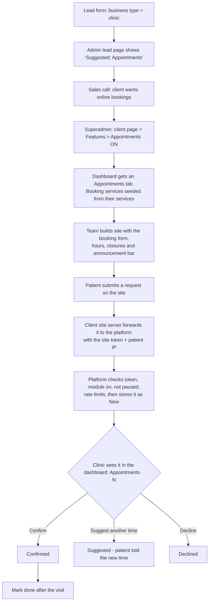

> Superseded by docs/superpowers/plans/2026-09-25-slot-booking.md for booking; admin switch, hours/closures/announcement and site info remain as described.

# Business modules: appointments, opening hours and announcements

**Status:** built and tested locally end to end (phases 1–3). Date: 2026-09-25.

> **Update, 2026-09-25 (user decision): no emails.** Appointments send no email to the clinic or the patient, and
> there is no notification-email setting. The dashboard's "Appointments · N" count (refreshed on focus and every
> 60 seconds) is how a clinic notices new requests. The patient's optional email is kept as contact information only.
> Every email mention below is superseded by this note.

## Goal

A clinic, dentist, salon or physio that runs on Fynix can take appointment requests from its own website and
manage them in the Fynix dashboard. Every client can also keep the everyday facts on their site current without a
change request: opening hours, holiday closures and a one-line announcement.

## Decisions already made

- **Modules, not per-industry builds.** Appointments is the first module. Table bookings (restaurants) and quote
  requests (trades) can come later through the same switch.
- **The superadmin switches a module on per business.** The lead's business type only suggests a module. Staff decide.
- **Version 1 takes appointment requests, not instant booking.** The business confirms each one, suggests another
  time, or declines it. There are no live time slots, no double-booking logic and no calendar sync.
- **Clients edit their business facts in fields we define, never through a page editor.** Page text, photos, new pages
  and design stay billed change requests.
- **Announcement bar, for every client:** one line of plain text with start and end dates, clearing itself when it
  ends.
- **Pricing (assumed, confirm):** Appointments is included in the base plan for now. No billing change is designed
  here. If it later becomes a paid add-on, it needs new plan rows, because a plan someone is subscribed to is never
  edited in place.

## The flow end to end



What the client controls after launch:

| Area | Who can use it | What they can do |
|---|---|---|
| Appointments | Businesses with the module | Confirm, suggest another time, decline, mark done, add a private note |
| Booking settings | Businesses with the module | Pause online booking with a message, edit the services shown in the booking form |
| Opening hours | Every client | Edit the weekly hours they gave in onboarding |
| Closures | Every client | Add date ranges such as "12–14 Nov, Diwali" |
| Announcement | Every client | One line, up to 100 characters, with a start and an end date |
| Blog | Every client | Already built |

Only the superadmin controls the module switch, the business time zone, design, domain and SEO.

## Architecture

The platform owns the data. The static client sites read it and post to it through the platform's site API. That API
already serves blog posts, so this adds one read endpoint and one write endpoint beside `/api/site/posts`.

Units, each with one job:

1. **Module switch** (`packages/db` table + queries, `packages/shared` pure helpers, admin panel). Answers "is module
   X on for business Y?" Everything else asks it.
2. **Business facts** (hours, closures, announcement, time zone). Customer editing pages, the queries behind them, and
   pure functions that decide what is active today.
3. **Site info API** (`GET /api/site/info`). Read-only snapshot a client site renders. It knows nothing about how the
   data is edited.
4. **Appointment intake** (`POST /api/site/appointments`). Validates and stores a request. Every check it makes goes
   through units 1 and 2.
5. **Appointment inbox** (customer dashboard pages + actions). Moves a request through its statuses.
6. **Notifications** (`packages/email` templates). Pure functions that build an email. Sending stays best-effort
   after the write and never undoes it.
7. **Client-site kit** (in the client-site starter repo, not this monorepo): announcement bar, hours block and
   booking form, plus the site's own server route that forwards the form.

### Data model

New migrations start at `0041`. The change-requests plan also claims `0040`/`0041`, which are now stale. Whichever
lands second renumbers.

All tables below follow the existing pattern: uuidv7 ids, `business_id` foreign key, RLS enabled, a
`*_tenant_*` policy for `fynix_app` on `business_id = app_current_business_id()`, an allow-all `*_staff_all`
policy for `fynix_staff`, and grants narrowed to what the query layer uses. As in `0014`/`0016`, tables go in one
generated migration and grants/RLS in a hand-written `_grants` migration.

**`business_modules`**: which modules a business has.
- `business_id`, `module` (pgEnum `business_module`: `appointments` for now), `enabled` (bool),
  `changed_at`, `changed_by_user_id` (the staff user). Primary key `(business_id, module)`.
- `fynix_app`: SELECT on its own rows only. Only staff write.
- A row with `enabled = false` keeps the history of the last change. No row means the module was never on.

**`businesses.time_zone`**: IANA name such as `Asia/Kolkata`, nullable text column. Staff set it on the client page.
It is required before Appointments can be switched on, because "today", closures and announcement dates are all read
in the business's own time zone. It is validated with `Intl.supportedValuesOf("timeZone")`.

**`business_hours`**: already exists (onboarding). No schema change. The customer gets a post-launch page that reuses
the onboarding hours editor and `replaceBusinessHours`.

**`business_closures`**: holidays and one-off closures.
- `id`, `business_id`, `starts_on` (date), `ends_on` (date, check `ends_on >= starts_on`), `note` (1–80 chars,
  optional), `created_at`.
- Past closures are hidden in the UI and left out of the API, not deleted.

**`business_announcements`**: one per business.
- `business_id` (primary key), `message` (1–100 chars, check), `starts_on`, `ends_on` (dates, `ends_on >= starts_on`),
  `updated_at`.
- Plain text only. The site renders it as text, never HTML.

**`appointment_settings`**: one per business with the module.
- `business_id` (primary key), `accepting` (bool, default true), `paused_message` (≤160 chars, nullable),
  `notify_emails` (text[] of 1–3 addresses, check on length).
- Created when the module is first switched on, with `notify_emails` defaulting to the owner's email.

**`appointment_services`**: what a patient can pick in the booking form.
- `id`, `business_id`, `name` (1–80), `position`, `archived_at`.
- Seeded from the business's onboarding `services` when the module is first switched on, then independent. Renaming a
  booking service must not change the website's services page, which is website content.

**`appointment_requests`**
- `id`, `business_id`
- `patient_name` (1–80), `phone` (5–30), `email` (nullable, validated)
- `service_id` (nullable fk) and `service_name` (text snapshot, so archiving a service keeps old requests readable)
- `preferred_date` (date), `preferred_window` (pgEnum `morning | afternoon | evening | any`)
- `patient_note` (≤300, nullable)
- `status` (pgEnum `appointment_status`: `new | confirmed | suggested | declined | done | cancelled`)
- `scheduled_for_date` (date) and `scheduled_for_time` (time), set on confirm or suggest, in the business's
  local time
- `clinic_note` (≤500, private, never sent to the patient), `decline_reason` (≤200, nullable, may be emailed)
- timestamps: `created_at`, `confirmed_at`, `suggested_at`, `declined_at`, `done_at`
- `handled_by_user_id`
- Index `(business_id, status, preferred_date)`.
- `fynix_app`: SELECT on own rows, UPDATE only on the status/schedule/note columns (column grants). There is no
  customer INSERT or DELETE. Requests only arrive through the intake endpoint.

**Status transitions** (each one a single conditional `UPDATE … WHERE status IN (…)`, the pattern from the
change-requests plan):

| From | Action | To |
|---|---|---|
| new, suggested | Confirm (date + time, default the preferred date) | confirmed |
| new | Suggest another time (date + time) | suggested |
| new, suggested, confirmed | Decline / cancel (optional reason) | declined (before confirm) or cancelled (after confirm) |
| confirmed | Mark done | done |

`suggested` means the clinic proposed a time and is waiting on the patient, usually by phone. The clinic confirms
once the patient agrees. There is no patient-facing link in v1.

### Site API

Both endpoints authenticate like `/api/site/posts`: `Authorization: Bearer <site token>`, resolved to a tenant and
then to its `businessId` (the Payload `tenants.businessId` field). Unknown and missing tokens get the same 401.

**`GET /api/site/info`**: `Cache-Control: public, max-age=60`, CORS `*`, GET/OPTIONS.

```ts
type SiteInfo = {
  business: string;
  timeZone: string | null;
  hours: { dayOfWeek: number; opensAt: string | null; closesAt: string | null; closed: boolean; openAllDay: boolean }[];
  closures: { startsOn: string; endsOn: string; note: string | null }[]; // current and upcoming only
  announcement: { message: string; endsOn: string } | null;               // only while active today
  booking: null | {                                                        // null when the module is off
    accepting: boolean;
    pausedMessage: string | null;
    services: { id: string; name: string }[];
  };
};
```

The contract lives in `apps/platform/lib/site-info.ts` with the same "additive changes only" rule as `SitePost`,
because client sites deploy on their own schedule. The client-site starter keeps an identical copy.

**`POST /api/site/appointments`**: server-to-server only. The client site's own route handler calls it, never the
browser, so the site token is never exposed in the page.

- Body: `{ fields: { name, phone, email?, serviceId?, preferredDate, preferredWindow, note?, website /* honeypot */ },
  clientIp }`, zod-validated, 16 KB cap, the same shape and checks as `/api/leads`.
- Refusals, in order: 405, 401 (token), 415, 413, 400 (shape), then:
  - 403 `booking_unavailable` if the module is off or the business has no time zone
  - 409 `booking_paused` with the paused message if `accepting = false`
  - 422 with field messages: date in the past (business time zone) or more than 90 days ahead, a closed weekday or
    closure, or an unknown or archived service
  - 429 when rate-limited
- A filled honeypot gets a fake 200, as for leads.
- Rate limits (existing `consumeRateLimit`, hashed keys):
  - `appt:business:<id>` 200 a day
  - `appt:ip:<ip>` 5 an hour
  - `appt:phone:<business>:<phone>` 3 a day
- Writes run on the staff connection, added to the sanctioned list in `lib/server/db.ts`. The token has already
  proven which business it is, and the check reads module and settings rows the public role can't see. Everything
  written is scoped to that one `business_id` in code, and a test covers it.
- The response is `{ ok: true }` only. The patient's data is never echoed back.
- After the write, an outbox email goes to each `notify_emails` address (best-effort).

Why server-to-server: the blog token already stays on the client site's server. Putting it in the browser would let
anyone post requests to any clinic. This matches how the marketing site calls `/api/leads`.

### Customer dashboard

The nav in `customer-shell.tsx` gains two items:

- **Appointments** `/appointments`, only when the module is on, with a count of `new` requests.
  - List grouped by **New · Upcoming · Past**. Each row shows name, service, preferred or scheduled time, a one-tap
    `tel:` link and an email link.
  - Row actions: Confirm (date and time picker, prefilled), Suggest time, Decline, Mark done, private note.
  - `/appointments/settings`: a pause switch with its message, the booking services (add, rename, reorder,
    archive) and the notification emails.
- **Your details** `/details`, for every client:
  - opening hours (the onboarding editor, reused)
  - closures
  - the announcement: a text field with a live character count and start and end dates

Access rules:
- Every page calls `requireCustomerAccess()`. The business id always comes from the session, never the form.
- Writes are blocked until the first payment (`paidCustomerOrNull()`, as for the blog).
- Appointments pages 404 when the module is off, so a stale tab or link can't reach them.
- Owner and editor see the same thing. A separate receptionist login needs team invites, which don't exist yet.
  That's out of scope here.

Follow the dashboard rule: whitespace and short labels, no boxed cards, no explanatory paragraphs.

### Admin

- **Client page, new "Features" section** next to "Their website":
  - Time zone select, required before the switch can be turned on.
  - Appointments on/off switch.
    - Turning it on creates `appointment_settings` and seeds `appointment_services` the first time only.
    - Turning it off asks for confirmation. It hides the tab and makes the intake endpoint refuse. Nothing is deleted.
  - Counts: new and total requests. Staff don't browse patient details here. That needs a support reason and is out
    of scope.
- **Lead page:** "Suggested: Appointments" when `business_type` is `clinic`, `salon` or `fitness`, from a pure
  `suggestedModules(businessType)` in `packages/shared`.
- Actions follow the existing pattern: `requireStaffAccess()`, zod-parsed id, `getStaffDb()`, `revalidateClient`,
  and a notice query param.

### Emails

None. Removed by the user's decision on 2026-09-25 (see the update at the top).

### Client-site kit (client-site starter repo)

- `lib/site-info.ts` (contract copy) and `getSiteInfo()`, fetched with `revalidate: 60`. If it fails, render the last
  good data. Without it, hide the announcement and booking and show hours from the build.
- `<AnnouncementBar>`: plain text, top of every page.
- `<OpeningHours>` and closures notice.
- `<BookingForm>` → the site's own `app/api/book/route.ts`, which adds the token and the visitor IP and forwards to
  the platform.
  - The date picker disables closed days and closures.
  - Field copy says "Please don't include medical details."
  - When paused or off, it shows the paused message or "Call us to book" with the phone number.
- Tested first on `fynix-test-client-site`.

## Privacy

- Minimum fields: name, phone, optional email, service, preferred day and time window, and a short note. No health
  history. The form tells patients not to include medical details.
- Patient data is visible only to that business's members (RLS) and the superadmin.
- Retention: requests are deleted 12 months after their scheduled or preferred date. This is built in phase 4 as a
  scheduled job and stated in the client-facing terms before the first clinic goes live.
- US clinics: storing appointment requests for a US healthcare provider may bring in HIPAA. Until that is reviewed,
  offer the module to non-US clients, or to US businesses that aren't covered entities (salons, fitness).

## Error handling

- **Module turned off mid-flow:** intake returns 403 `booking_unavailable`, and the site form falls back to "Call us".
- **Two people handle the same request:** the conditional UPDATE lets exactly one win. The other sees "This request
  was already updated" and the refreshed row.
- **Email failure:** logged. The request and its status change are already saved, and the dashboard stays correct.
- **Platform down:** the site keeps its last cached info. The booking form shows "Call us". Nothing is lost silently
  because the patient sees the failure.
- **Bad time zone or missing settings row:** the switch can't be turned on without a time zone, and turning it on
  creates the settings in the same transaction.

## Testing

- **Pure unit tests** (`packages/shared`):
  - `activeAnnouncement(today)`, `upcomingClosures(today)` and `isBookableDate(date, hours, closures)` across time
    zone edges
  - `suggestedModules`
  - status transition table
- **Integration tests** (`packages/db`, `*.integration.test.ts`):
  - RLS: business A can't read or update B's requests, closures, announcement or settings
  - `fynix_app` can't insert requests or write `business_modules`
  - each transition only from its allowed states
  - seeding happens once
- **Handler unit tests** (platform): every refusal code on the intake endpoint, the honeypot, rate limits, and that a
  request is written only for the token's business.
- **Templates:** escaping of patient-supplied text in every email.
- **End to end on the test client site:** switch on in admin, submit on the site, see it in the dashboard, confirm,
  check the outbox. Then pause and check the site shows the paused message. Then switch off and check the form falls
  back.

## Build order

Each phase ships on its own and is useful without the next.

1. **Module switch and time zone:** `business_modules`, `businesses.time_zone`, the admin Features section and the
   lead-page hint. Nothing customer-facing yet.
2. **Business facts for every client:** closures, announcement, the post-launch hours page, `GET /api/site/info`,
   and the announcement bar, hours and closures in the client-site kit.
3. **Appointments:**
   - the settings, services and requests tables
   - `POST /api/site/appointments`
   - the dashboard inbox and settings
   - the four email templates (outbox)
   - the booking form in the client-site kit
4. **Go-live hardening:** real email delivery (dependency), the retention job, and the privacy wording in the terms.
   Then the first real clinic.

## Out of scope

- Instant booking with live slots, calendar sync (Google or Outlook), SMS or WhatsApp reminders, patient
  self-cancel links, deposits or payments.
- Team invites and a restricted receptionist role.
- Table bookings and quote requests. They reuse the module switch later, each with its own spec.
- Charging for modules.
