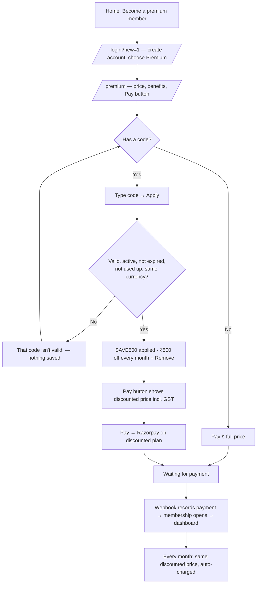
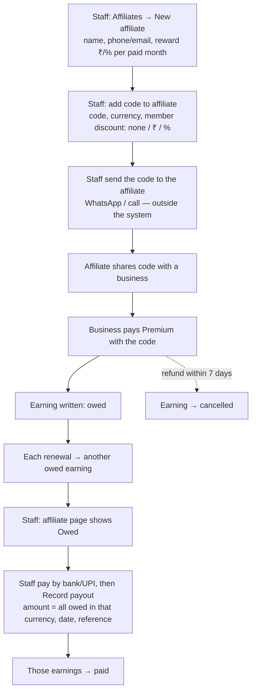
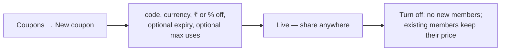

# Affiliates and coupons for Premium Membership — design

**Date:** 2026-10-06
**Status:** approved; implemented 2026-10-06 (uncommitted). See "Changed during implementation" at the end.
**Branch / worktree:** `feat/affiliates-coupons` → `fynix-platform/affiliates-coupons` (off `origin/development`)
**Surfaces:** customer dashboard `/premium` (`apps/platform`), staff console (`apps/admin`), `packages/db`, `packages/billing`, `packages/shared`
**Builds on:** `2026-09-22-referral-codes-design.md` (Phase 1 referral codes, on development incl. the percentage option `ae16d38`)

## What this adds

Two things that look the same to a member but are different to the business:

| | Coupon | Affiliate code |
|---|---|---|
| What it is | A discount code. Nobody is paid. | A code that belongs to an affiliate, a person we pay for bringing members. |
| Discount for the member | Always (fixed amount or %) | Optional, set per code. Can be zero. |
| Discount lasts | Every month, for the life of the membership | Same |
| Reward | None | The affiliate earns every month the member pays (fixed amount or %) |
| Who sees the money | — | Staff console, and (from 2026-10-08) the affiliate's own coupon dashboard. |

Scope: there is one plan, Premium Membership. Codes are typed on `/premium`, and on Check and send, which is the
same plan reached through onboarding.

## Decisions taken (2026-10-06)

| Question | Decision |
|---|---|
| Relation to today's referral codes | Split into coupons + affiliates; today's codes become affiliate codes |
| Products | Premium Membership only |
| Coupon duration | Every month, for the life of the membership |
| Affiliate reward | Every paid month; fixed amount or percentage |
| Member discount on affiliate codes | Optional per code |
| Stacking | One code per membership. One field takes either kind |
| Affiliate visibility | Staff console; from 2026-10-08 also the affiliate's own sign-in (a link staff make on the affiliate page, then `/affiliate`: their coupon, members count, earnings, payouts; no member names) |
| Discount at Razorpay | Discounted Razorpay **plan**, created automatically. Razorpay Offers are retired |

## Data model

Migrations: **0091** (tables, data copy, grants), **0092** (drops retired columns), **0093** (month limit).

### New table `affiliates`

| Column | Type | Notes |
|---|---|---|
| `id` | uuid pk | uuidv7 |
| `name` | text | 1–120 chars |
| `email` | text null | 3–254 chars when present |
| `phone` | text null | E.164; at least one of email / phone required |
| `reward_kind` | `referral_value_kind` | `amount` or `percent` (enum from 0046) |
| `reward_amount_cents` | integer null | Set when kind = amount, ≥ 0 |
| `reward_currency` | `billing_currency` null | Set when kind = amount — a fixed reward needs a currency |
| `reward_percent_basis_points` | integer null | Set when kind = percent, 1–10000 |
| `active` | boolean default true | Off = its codes stop working for new members; existing members keep earning it money |
| `notes` | text null | Bank details are **not** stored here — staff keep them outside the system |
| `created_by_staff_id` | text → users.id | |
| `created_at`, `updated_at` | timestamptz | |

The reward lives on the affiliate, not on the code: it is what we pay a person, whichever of their codes was used.
It is freely editable; an edit applies to payments recorded after it, never to earnings already written.

### Changes to `referral_codes`

- Add `affiliate_id uuid null → affiliates.id`. **Null = coupon. Set = affiliate code.**
- The discount may now be **none**: add `none` to the discount rule (`discount_kind = 'none'`, both value columns null),
  allowed only when `affiliate_id is not null`. A coupon must always discount.
- `referrer_name`, `referrer_email`, `reward_*` columns: data copied to `affiliates` by the migration, then the
  columns are dropped in the same migration (development data only; no production codes exist).
- `provider_offer_id`: no longer read or written. Dropped in the same migration.
- Kept unchanged: `code`, `currency`, discount columns, `active`, `expires_at`, `max_redemptions`, the format check,
  the "cannot delete once a subscription points at it" rule.

**Data migration:** every existing code gets one `affiliates` row from its `referrer_name` / `referrer_email` and
its reward, and points at it. Same referrer email on several codes → one affiliate.

`subscriptions_discount_check` (`referral_code_id is null` ⇔ `discount_amount_cents = 0`) must change, because an
affiliate code with no discount sets a code and a zero discount. New rule: `discount_amount_cents >= 0` and
`referral_code_id is null ⇒ discount_amount_cents = 0`.

### New table `provider_discount_plans`

| Column | Notes |
|---|---|
| `id` | uuid pk |
| `plan_id` | → plans.id, the base plan |
| `discount_amount_cents` | integer > 0, pre-tax, the frozen figure from checkout |
| `provider` | `billing_provider_name` |
| `provider_plan_id` | text, Razorpay `plan_xxx` |
| `created_at` | |

Unique `(plan_id, discount_amount_cents, provider)`. Staff connection only, like the rest of billing.

### New table `affiliate_earnings`

| Column | Notes |
|---|---|
| `id` | uuid pk |
| `affiliate_id` | → affiliates.id |
| `referral_code_id` | → referral_codes.id (which code brought the member) |
| `business_id` | → businesses.id |
| `payment_id` | → payments.id, **unique** — one earning per payment, ever |
| `amount_cents`, `currency` | What we owe for this payment |
| `basis_cents` | What the member paid before GST and after discount — the figure a % reward was taken of |
| `status` | `owed` · `paid` · `cancelled` |
| `payout_id` | → affiliate_payouts.id, null until paid |
| `created_at`, `cancelled_at` | |

A zero reward writes no row.

### New table `affiliate_payouts`

| Column | Notes |
|---|---|
| `id` | uuid pk |
| `affiliate_id` | |
| `amount_cents`, `currency` | Equals the sum of the earnings it settles (checked in the query, in one transaction) |
| `paid_on` | date the bank transfer went out |
| `reference` | text, the bank/UPI reference |
| `recorded_by_staff_id`, `created_at` | |

Payouts are per currency. An affiliate with INR and USD earnings gets two payouts.

## How money moves

### Checkout (Premium)

`startMembershipCheckoutFor` already reads `businesses.referral_code_id`, re-validates it under the lock and freezes
`discount_amount_cents` on the subscription. Changes:

1. If the discount is greater than 0 and the provider is Razorpay, call `ensureDiscountPlan(basePlan, discountCents)`:
   - look up `provider_discount_plans`; if found, use its `provider_plan_id`;
   - else call `provider.createPlan({ netMonthlyCents: base − discount, taxRateBasisPoints, currency, code })`
     **outside the transaction** (network call), then `insert … on conflict do nothing` and read back — two
     simultaneous first uses create at most one extra unused Razorpay plan and both use the stored one.
2. `StartCheckoutInput` replaces `offerId` with `providerPlanIdOverride`. Razorpay creates the subscription on that
   plan. Fake provider ignores it and subtracts the discount as today.
3. Our subscription row still points at the **base** plan. The webhook's expected amount is already
   `chargedAmountCents(plan, discount, tax)`, which equals what the discounted Razorpay plan charges — unchanged.

Rounding: the discounted plan's charged amount is `chargedAmountCents(base − discount, 0, tax)` and our expectation
is `chargedAmountCents(base, discount, tax)`. These are the same function input, so they are equal by construction.
A unit test asserts it for every discount in a sweep.

### Earnings

Inside `recordPaymentAndActivate` (the single path for first payments and renewals: Razorpay webhook, fake
confirm, admin manual payment), in the same transaction, after the payment row is inserted:

- if the subscription has a `referral_code_id` whose code has an `affiliate_id`, compute
  `rewardCentsFor(affiliate.reward, paidPreTaxCents)` and insert an `owed` earning;
- `on conflict (payment_id) do nothing`, so webhook retries never double count.

Fixed-amount reward in a different currency from the payment: no earning, and the payment is flagged for staff
attention (`affiliate_currency_mismatch`). The console prevents creating that combination, so this is a guard only.

When a payment's status becomes `refunded`, its `owed` earning becomes `cancelled`. If it was already `paid`, it
stays paid and the console shows "refunded after payout" against that affiliate so staff can settle it by hand.

## User flows

### Member — Premium with a code

Screen text on `/premium` (short, per the dashboard rule):

- Field: placeholder "Code", button "Apply".
- Applied: "**SAVE500** · ₹500 off every month" · "Remove".
- Affiliate code with no discount: "**PRIYA** applied" · "Remove" (no price change, nothing about the affiliate).
- Invalid: "That code isn't valid."
- The field is hidden while a checkout is unsettled (the page already waits then), and after payment.

### Affiliate — from invite to payout

The affiliate never signs in. Everything they see comes from staff.

### Staff — coupons

## Staff console

Follows "no boxes, no text": hairline lists, figures, short labels. The dock's "Referrals" item becomes two:
**Coupons** and **Affiliates**. `/referrals/*` routes redirect to `/coupons`.

- **`/coupons`** — figures: Coupons · Usable now · Members using. List: code, "₹500 off" / "10% off", currency,
  uses, Off/Expired/Used up dot. **New coupon** form: code, currency, discount (₹ or %), expiry, max uses. The live
  "Razorpay Offer" line and Offer id field are removed.
- **`/coupons/[id]`** — the coupon, its members (business, since), Turn off / Delete (delete only when unused).
- **`/affiliates`** — figures: Affiliates · Members brought · Owed (per currency). List: name, members, earned,
  owed.
- **`/affiliates/new`** — name, phone, email, reward (₹ or % per paid month).
- **`/affiliates/[id]`** — reward (editable, note "applies to future payments"), codes (+ Add code), members
  (business, since, still paying?), earnings (date, business, amount, status), payouts, **Record payout**.
- **Record payout** — pre-filled with everything owed in one currency; staff enter date and reference. Refuses if
  the owed set changed since the page loaded (optimistic check on the earning ids).

## Errors and edge cases

| Case | Behaviour |
|---|---|
| Code typed in lower case / spaces | Normalised (existing `normaliseReferralCode`) |
| Code turned off after a member applied it but before paying | Re-validated under the checkout lock → refused, applied code cleared, member sees "That code isn't valid." |
| Code turned off after a member paid | Member keeps their discount; affiliate keeps earning |
| Affiliate turned off | Its codes stop working for new members; existing members unchanged; earnings keep accruing |
| `createPlan` fails at Razorpay | Checkout refused with the existing "payments are unavailable, try again" problem; nothing frozen |
| Discount ≥ plan price | Refused at code creation and again at checkout (`isChargeableDiscount`) |
| Webhook retry | Unique `payment_id` on earnings → no double count |
| Member applies a code then the business changes currency | Currency check at checkout refuses it |
| Base plan repriced (new plan row) | New discounted Razorpay plan created on first use against the new base; old subscribers untouched |

## Testing

- **Unit (`packages/billing`):** discounted-plan price equals webhook expectation for a sweep of amounts and
  percentages, INR (18% GST) and USD (0%); reward maths already covered — extend for `none` discount.
- **Integration (`packages/db`):** migration copies referrers to affiliates and drops old columns; `discount_kind
  = 'none'` only with an affiliate; earning written once per payment; refund cancels an owed earning; payout settles
  exactly the listed earnings and refuses a stale set; `ensureDiscountPlan` race inserts one row.
- **Platform:** `/premium` apply / remove / invalid / hidden-while-waiting; `startMembershipCheckoutFor` passes the
  discounted plan id.
- **E2E (fake provider, own DBs `fynix_platform_branch` / `fynix_platform_branch`):** Premium sign-up with a coupon; with an
  affiliate code with discount; with an affiliate code without discount; simulated renewal; refund; payout.
- **Razorpay test mode:** one real discounted subscription, once the test account has Subscriptions enabled (the
  last attempt got a 401 from the Plans API).

## Out of scope

Affiliate login or portal; emailed statements; stacking two codes; coupons on directory ad tags; first-month-only or
N-month coupons; storing affiliate bank details; automatic payouts. (Premium's ₹6,999 price is set on the staff
Pricing page, not here; discounts are measured against whatever the active plan is.)

## Changed during implementation (2026-10-06)

- **No-discount affiliate codes** are `discount_kind` null with both value columns null (allowed only with an
  affiliate), not a new enum value: Postgres cannot use an enum value added in the same migration transaction.
- **Refunds.** Nothing in the codebase marks a payment `refunded` (refunds are handled by hand), so instead of an
  automatic cancel, staff press **Cancel** on an owed earning on the affiliate page.
- **Currency mismatch** is prevented in the console (a fixed reward's currency must match the affiliate's codes, both
  when adding a code and when editing the reward). Accrual still guards: a mismatch writes no earning and logs
  `affiliate-currency-mismatch`; no new attention reason was added.
- **Where earnings are written:** `packages/shared/src/server/affiliate-accrual.ts`, called from
  `activateFirstPayment` and `activateRenewalPayment` (the only callers of `recordPaymentAndActivate`), because
  `packages/db` cannot import `rewardCentsFor` from `packages/billing`.
- **Migrations:** 0091 (tables, `affiliate_id`, relaxed checks, data copy, grants, RLS) and 0092 (drops the referrer,
  reward and Offer columns). The `affiliates` table lives in `schema/referrals.ts` to avoid an import cycle.
- **Codes' detail page** is `/coupons/[id]` for both kinds; an affiliate code links back to its affiliate.
  `/referrals/*` redirects to `/coupons/*`.

## Edge cases closed after review (2026-10-06)

- **Self-referral:** an affiliate's code is refused for a member whose proven phone or real email is the affiliate's
  ("That's your own affiliate code…"). A phone account's placeholder email never matches.
- **Code for an affiliate who is off:** refused at creation in the console. A code whose affiliate is off reads
  "Affiliate off" on its page and "Off" in the affiliate's code list.
- **Expiry already passed:** refused when creating a code (editing to a past date is allowed, as a way to retire it).
- **Code stops working after it was applied:** `/premium` and Check and send say "Code X can't be used any more, so
  the full price applies" instead of the discount silently vanishing.
- **Payout dates:** the form starts on India's date (Asia/Kolkata), and a date after today is refused.
- **Uneven plans:** a discounted Razorpay plan is refused (`UnevenPlanDiscountError` → "payments unavailable") for a
  base plan whose first payment differs from its monthly price, since one provider plan could not match both.

Known, accepted: a `max_redemptions` cap counts only paid members, so two members paying at the same moment can
exceed it by one.

There is one plan, Premium Membership (₹6,999 + GST, set from the staff Pricing page). Check and send is the
same plan for members who onboard through it, so the code field there takes the same codes.

## Affiliate month limit (added 2026-10-06)

The superadmin sets, per affiliate, **for how many paid months** each member earns them (`affiliates.reward_cycles`,
1–120; blank = every month). It is counted per member: with a limit of 12, each member's first 12 paid months earn,
and from month 13 that member earns the affiliate nothing. The member's discount is unaffected and runs for as long as
they stay. Every earning records its month (`affiliate_earnings.cycle_number`, shown as "Month 3 of 12"). A month whose
earning staff cancelled (a refund) does not use up the limit. Changing the limit applies to later payments only.
Migration 0093 (backfills `cycle_number` for existing earnings).
